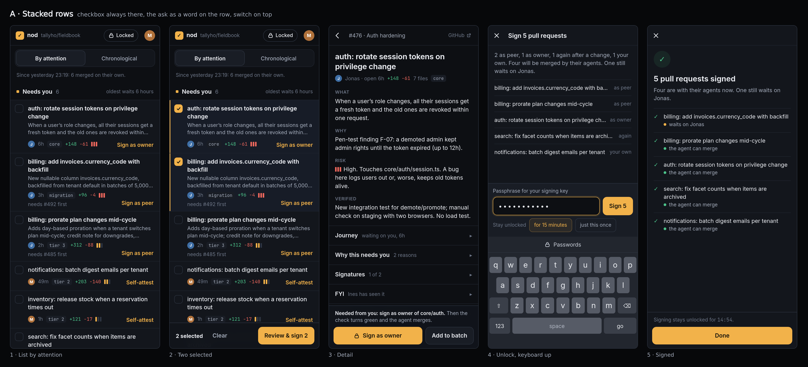
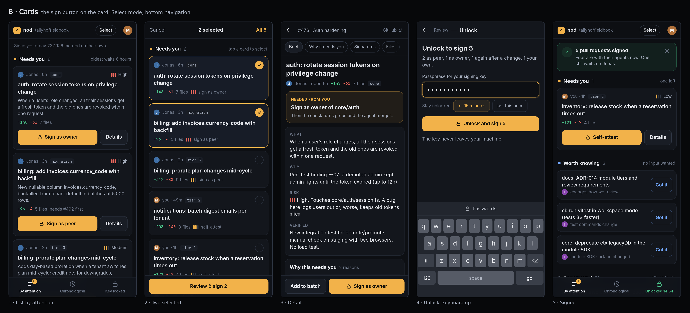
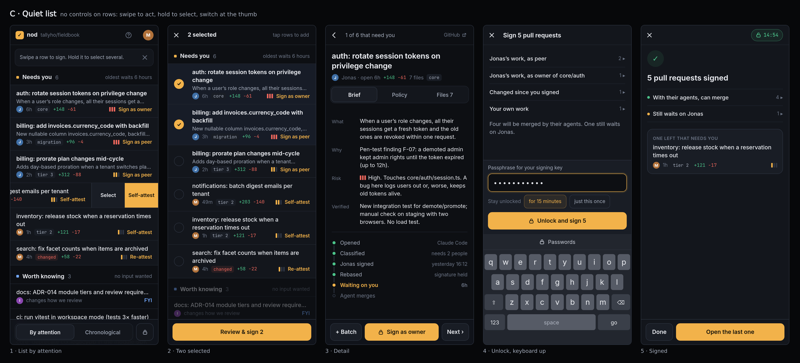

# Round m1: nod on the phone

Three directions for the phone, the same five screens each, for epic #30. Mockups only; r3 stays the desktop reference and nothing in `src/` changed.

- `app/index.html`: self-contained, a real responsive page. Open it on a phone or at 390 px. States by hash: `#a-list`, `#a-select`, `#a-detail`, `#a-detail-2`, `#a-unlock`, `#a-signed`, the same for `b` and `c`, plus `#c-detail-3`. Without a hash it lists them. Rows, checkboxes and buttons lead to the next screen.
- `screenshots/`: 390×844 at scale 2. `x-overview.png` shows a direction's five screens, `x-list-full.png` the whole list, `x-detail-2.png` the rest of the detail page.
- Source: `_src/app.html`, built by `_src/build.sh` (inlines the two fonts), shot by `_src/shots.sh`.

Given, and the same in all three: the list is the phone view, no board; the detail is a full page with a sticky action; batch and unlock are a full-screen sheet; r3 palette, type and tiers. The fake data is r3's.

## The directions

| | A · Stacked rows | B · Cards | C · Quiet list |
|---|---|---|---|
| Row | two to four lines, hairlines | one card per change | two or three lines, no controls |
| Whole list (6 + 3 + 3 rows) | 1570 px, 1.9 screens | 2230 px, 2.6 screens | 1200 px, 1.4 screens |
| Sign from the list | tap the ask, a word on the row | button on the card | swipe the row |
| Got it | tap the word | button on the card | swipe the row |
| Select | checkbox, always there | `Select` in the top bar, then tap cards | hold a row, then tap rows |
| By attention / Chronological | switch under the top bar | bottom navigation, with the key as third tab | switch in a bottom dock, next to the lock |
| Detail | brief, then folded sections | anchor chips, everything open as cards | three tabs: Brief, Policy, Files; `Next ›` walks the queue |
| Unlock | field docked on the keyboard, the five titles stay visible | its own step, field at the top, summary sentence only | field docked on the keyboard, grouped counts |
| Signed | result sheet, one line per PR | back on the list, a banner on top | result sheet, two counts and the one that is left |

**A · Stacked rows: the desktop list, stacked.** Every control is visible and is a tap: checkbox left, the ask as an amber word bottom right, the row itself opens the page. It is what the epic already describes, needs no gesture and no mode, and the tiers still read by height. Trade-off: the checkbox column costs 46 px on every row in *Needs you*, the author's name gives way to the avatar, and the ask is a word, not a button (44 px high, but it does not look like one).

**B · Cards: read and sign without opening anything.** A tier-1 card carries three lines of the brief, the risk in words and a full-width sign button. Selecting is a mode, so cards stay clean. Trade-off: two cards per screen. Six PRs that need you are 2.6 screens of scrolling, and the big button on the list invites signing from three lines of text. The bottom navigation spends 60 px on a switch that is used rarely.

**C · Quiet list: the most on one screen, hands at the bottom.** Rows have no controls, so the six that need you fit on one screen. Swipe signs or acknowledges, holding selects, the switch and the lock sit at the thumb, and the detail page walks the queue with `Next ›`. Trade-off: nothing shows that a row can be swiped or held, so it needs a hint and still gets missed. In a browser tab, a horizontal swipe competes with the back gesture, and holding a row competes with text selection and the link menu. Both are fragile outside an installed app.

## Recommendation

**A**, with two things from the others:

- from C, the detail page's `Next ›` and the "1 of 6 that need you" title. The phone's main entry is one PR from a notification; after signing it the natural question is what else waits.
- from B, the unlock step with the field at the top, if password managers matter more than seeing the list while typing (question 3).

Why A: the phone's jobs are triage, read, sign, Got it. A does all four with plain taps that work the same in Safari, Chrome and an installed app, it is the smallest step from the desktop components (`pr-row.tsx` stacks, nothing new to learn), and it keeps reading before signing: the list shows one or two lines, the page has the brief. B makes signing easiest where the least was read. C is the nicest to use once learned, but it rests on gestures a web page cannot own.

## Touch forms for keys and hover

| Desktop | Phone (all directions unless noted) |
|---|---|
| `x` select | A checkbox · B `Select` mode · C hold a row. On the page: `Add to batch` |
| `s` sign | the ask on the row (A, B), swipe (C), the sticky button on the page |
| `e` Got it | `Got it` on the row (A, B), swipe (C), the sticky button on an FYI's page |
| `?` legend | avatar menu, "How this list works" (C also a `?` in the top bar); opens a sheet |
| `g` views | the switch |
| `title=` on risk bars | the risk in words: on the card (B), in the brief ("High. …") |
| `title=` on times, diff bar, avatars | written out on the page: "Jonas · open 6h", "7 files"; the 38 px diff bar is dropped, the numbers stay |
| lock chip popover | tap the chip (A), the key tab (B), the lock button (C): the same sheet as unlock |

## Open questions

1. **Direction:** A as recommended, or B or C?
2. **Does the ask on a row sign in one tap** (opens the sheet for that one PR), or should the phone only sign from the page? A and B draw one tap. The sheet still shows what is signed before the passphrase.
3. **Unlock: field docked on the keyboard (A, C) or at the top (B)?** Docked keeps the titles in view and the button at the thumb. At the top is safer with a password manager's bar and with browsers that do not resize for the keyboard.
4. **Signed: a result sheet (A, C) or back on the list with a banner (B)?** The banner is one tap less; the sheet says per PR what happens next.
5. **Is the avatar enough on a row**, without the name? A and C drop "Jonas ·" to keep the meta on one line; the page has it.
6. **Does "needs #492 first" stay on the row?** It costs a line on two of the three top rows in A.
7. **Journey on the phone:** folded (A), a card at the end (B), under the brief (C), or left out?
8. **Chronological view:** not drawn. Assumed: the same rows under time buckets, the event in place of the age. Enough, or a screen in the next round?
9. **Light theme:** dark only, as the app today.

## Notes

- Checked at 360 and 390 px: no horizontal overflow in any state; every link is at least 44 px except the segments of a switch (38 px high, full width) and the "stay unlocked" chips (36 px).
- The keyboard is a drawing, and the passphrase field is read-only so a real keyboard does not cover it. The real sheet has to follow the visual viewport.
- Not drawn: onboarding, the deep-link landing before pairing, stale and posting-failed, the legend sheet.
