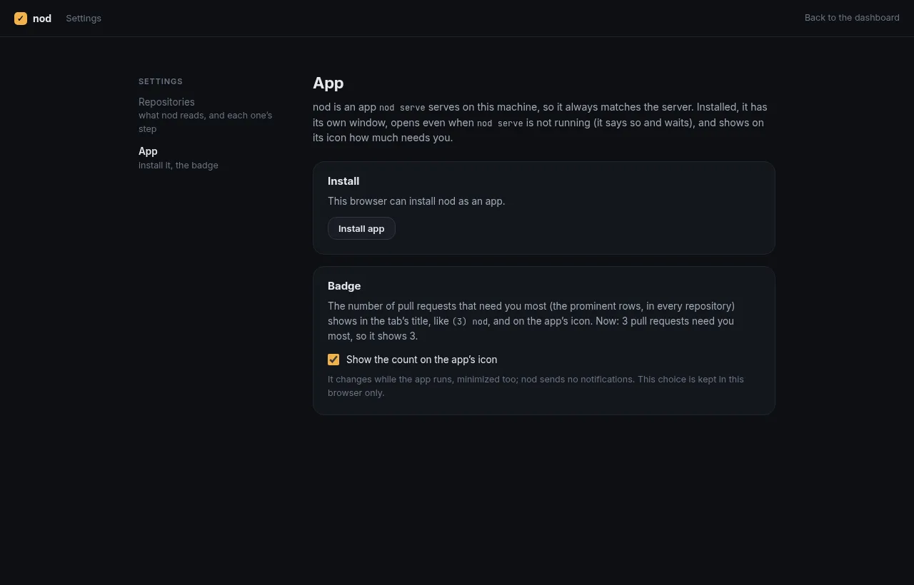
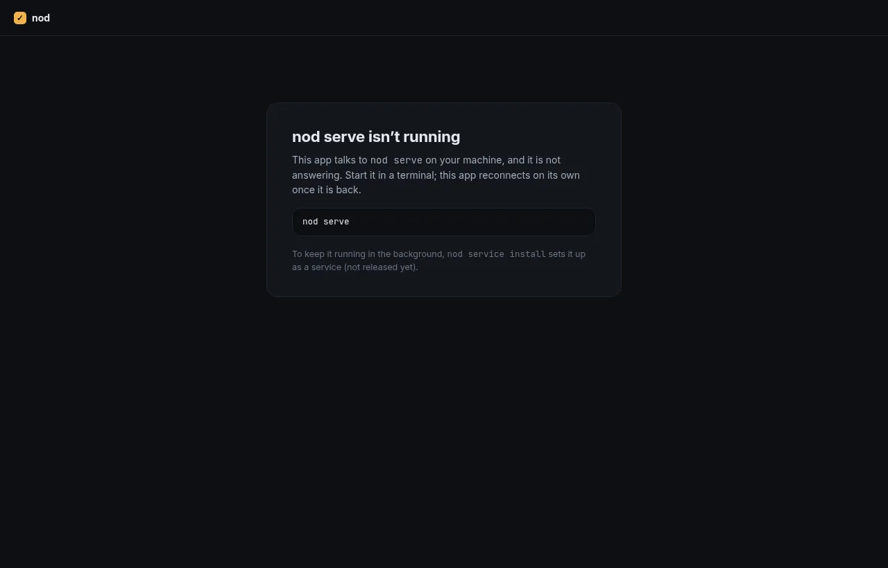

> **Not released.** The app is on `main`, so in the pre-release `@frebreco/nod@next`, not in a
> stable release yet. Until then the link `nod serve` prints opens the
> [hosted web app](/docs/glossary). From a checkout, run `bun run build` first; the link to the
> app is the second one `nod serve` prints.

The [dashboard](/docs/dashboard) is an app that `nod serve` serves itself, on your machine, at
`http://127.0.0.1:4518/` (or the port `--port` gives). It is the build of the very `nod serve` that
serves it, so the page and the server always speak the same version: after an update, and after a
downgrade too. The browser talks to the same address it loaded the page from, so it asks for no
permission to reach your machine.

## Open it

`nod serve` prints the link to open:

```
nod serve on ws://127.0.0.1:4518 · GitHub · tallyho/fieldbook

  open the dashboard:
  http://127.0.0.1:4518/#host=ws%3A%2F%2F127.0.0.1%3A4518&token=…
```

It is the [host link](/docs/glossary): it pairs this browser once, and the page takes the token out
of the address bar and the history right away. The token stays the same when `nod serve` restarts,
so later you open `http://127.0.0.1:4518/` (a bookmark, the installed app) and it is still
paired. Keep the link to yourself: while signing is unlocked, it can sign.

Use `127.0.0.1`, as printed. `http://localhost:4518/` is another address to a browser, with its
own storage and its own install; `nod serve` sends it on to `127.0.0.1`.

From a checkout of nod, the first link is the Vite dev server's, where the code changes; the
built app's link (after `bun run build`) is printed under it. `--web-url` makes another web app the
first link; the app is still served.

## Install it

In Chrome and Edge, **Install app** shows in the avatar menu and in Settings → App, or use the
install icon in the address bar. In Safari on a Mac: File, then Add to Dock. Firefox does not
install sites as apps. Settings → App says what this browser does, or that it is installed.

The [installed app](/docs/glossary) has its own window and icon. It is the same app at the same
address, with the same pairing; an update of nod changes it too.



## Without nod serve

The app keeps its own files in the browser, the ones of its version, so it opens even when
`nod serve` is not running, and says so with the command to start it:



It tries again on its own, every few seconds and at once when you come back to the window, and
shows the dashboard as soon as `nod serve` answers. Nothing else works offline: the dashboard
is what `nod serve` reads from GitHub.

To keep `nod serve` running in the background, `nod service install` sets it up as a service.
Not released, and not on `main` yet.

When `nod serve` comes back as another version, the open app loads that version's files once,
by itself.

## The badge

The [badge](/docs/glossary) is the number of pull requests that need you most: the prominent rows
of the [list](/docs/dashboard#attention-tiers), in every repository, whatever the repository
filter shows. It is in the tab's title, `(3) nod`, and, where the browser supports it (Chrome and
Edge on desktop, mostly), on the installed app's icon; at 0 there is none.

It changes while the app runs, minimized too. nod has no server of its own to send
notifications from, so a closed app shows no new count.

Settings → App has a switch for the icon's badge, kept in this browser; the title always counts.

## Links from GitHub

Links in pull request comments open the [hosted web app](/docs/glossary), which is not paired with
your machine. It hands the link over to the app ([link forwarding](/docs/glossary)): **Open in
the app** opens the pull request at `http://127.0.0.1:4518/`, one click per link. The link carries
no pairing and signs nothing.

If `nod serve` runs on another port, open the avatar menu in the app and choose **Open links from
GitHub here**: the hosted web app asks once whether to remember that address, in large type,
and remembers nothing unless you say so. A phone does the same for its [named host](/docs/phone#links-from-github).

A hosted web app that is still paired from before shows the link where it is.

## Security

- `nod serve` answers only to `127.0.0.1`, `localhost` and `[::1]` (and the [named
  host](/docs/phone)). A web page that points a name of its own at your machine (DNS rebinding)
  gets nothing: no page, no socket.
- Only the app's own address, the hosted web app and the dev server may open the socket, each
  with the pairing token.
- The app's files are served from the folder of the built app and nowhere else, and never inside
  another page's frame.
- The files the browser keeps never include the token: it is in the part of the address a browser
  never sends.

See also [Security](/docs/security).
