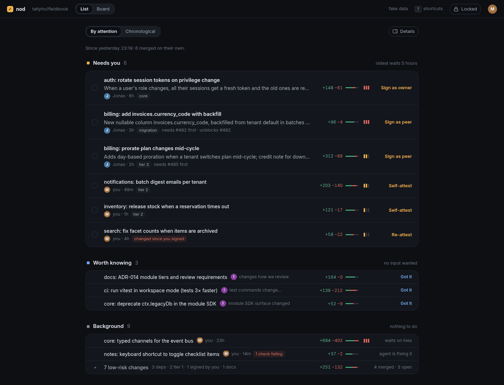
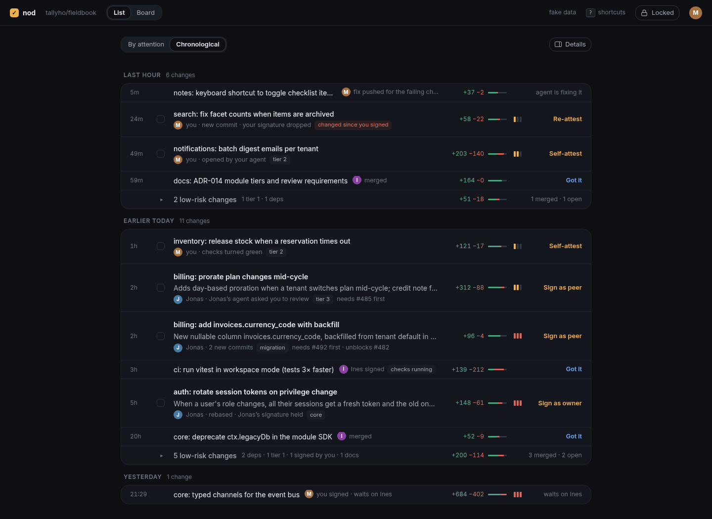
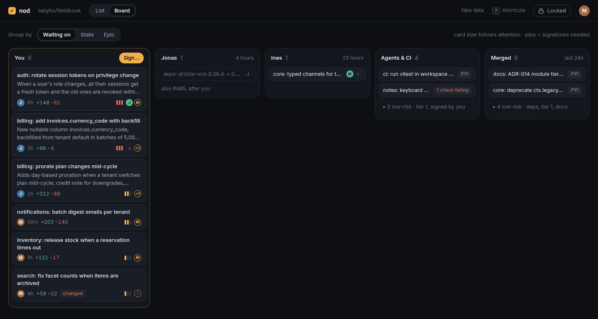
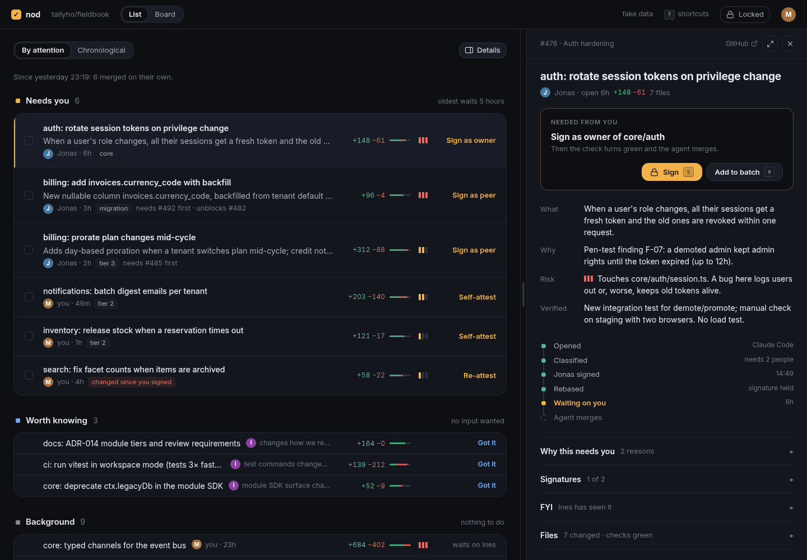
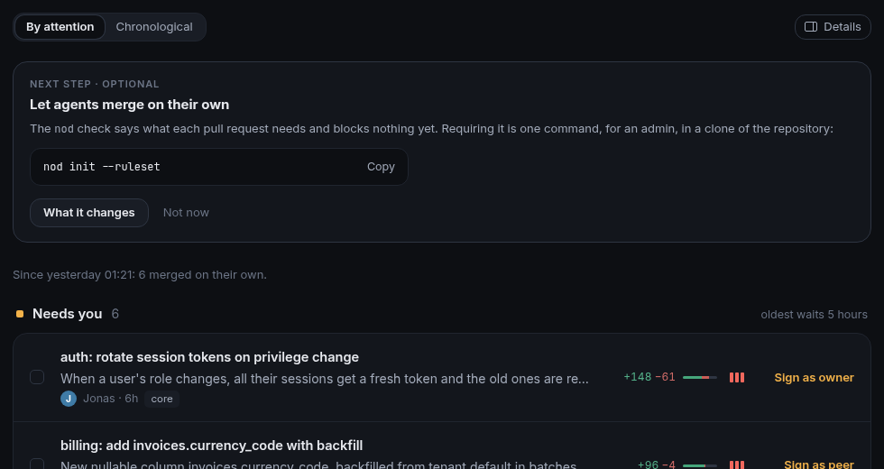
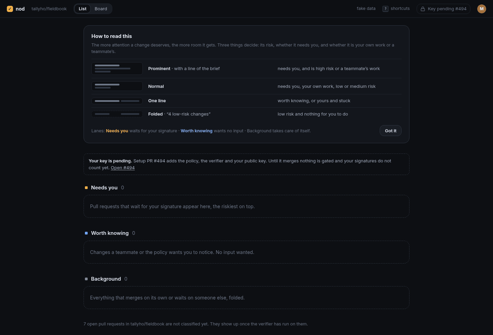

The dashboard is the web app, paired with the `nod serve` on your machine. It shows one
repository, from your point of view: the same pull request looks different to you and to a
teammate.

## Attention tiers

A list where every pull request has the same height tells you nothing about where to look. In
nod, the space a pull request gets follows the attention it deserves. There are four
**attention tiers**; the first rule that matches wins.

| Tier | When | Shown as |
| --- | --- | --- |
| **1 Prominent** | It needs your nod, and it is high risk or a teammate's work | Title, one line of the brief, who and age, diff, risk, the ask |
| **2 Normal** | It needs your nod, it is your own work, risk low or medium | Title, who and age, diff, risk, the ask |
| **3 One line** | An [FYI](/docs/nodding#fyi) you have not acked; or it is open and either yours and stuck, or high risk | Title, the reason to care, diff, "Got it" or the status |
| **4 Folded** | Everything else | Part of a cluster, "7 low-risk changes", that expands in place |

Why these rules:

- A teammate's pull request that needs you ranks above your own. You prompted yours and know
  what it is; you have not seen theirs.
- Your own work only gets room when it needs you or is stuck. Otherwise your agents are fine
  without you.
- An open high-risk pull request is never folded, even while it waits on someone else.
- **Stuck** means a check is failing, it conflicts with its base, a reviewer requested changes,
  or it has waited on a person for 12 hours or more. Not released: the conflict and the requested
  changes.

At the [inbox](#the-inbox) step there is no nod to give: "needs you" there means a review asked
of you, or your own pull request stuck. The same tiers apply.

Only tiers 1 and 2 have a checkbox: those are the pull requests you can nod, or, without a key
that signs, [approve](/docs/nodding#approve-or-nod). Your own stuck pull request at the inbox step
has none: there is nothing to do about it here.

Each row carries two small marks. The **diff indicator** is `+312 −88` and a short bar: its
length is the size on a log scale up to 1,000 lines, split into added and removed. Lockfiles and
generated files do not count. The **risk bars** are three bars, amber for low and medium, red for
high.

## List by attention

The default view. Three lanes, top to bottom:

- **Needs you**: pull requests that wait for your nod (at the [inbox](#the-inbox): for your
  review, or yours and stuck), sorted by tier, then risk, then age.
- **Worth knowing**: FYIs you have not acked. No input wanted.
- **Background**: everything else. The ones that are yours and stuck, or high risk, show as one
  line; the rest fold into one cluster at the end.

## Chronological

The second tab of the list answers a different question: what happened since I looked? It is
sorted by last activity (a push, a nod, a merge, a check result), and each row says what
happened instead of how old it is. Rows are grouped into time buckets: last hour, earlier today,
yesterday, this week, older. Folded pull requests form one cluster at the end of each bucket.

## Board

Columns instead of lanes. Group by:

- **Waiting on** (the default): You, one column per teammate who has to nod, Agents & CI, Merged.
- **State**: Checks running, Needs a signature, Signed · merging, Merged.

Card size follows the same tiers, and low-risk cards fold into a dashed cluster at the end of a
column. Grouping by epic is not built yet.

## Detail panel

<kbd>Enter</kbd> or the **Details** button opens the focused pull request in a side panel. In the
list it sits next to the rows and can be resized (380 to 900 px); on the board it is a drawer over
the columns. Moving the focus replaces its content.

It shows, in this order:

1. **Needed from you**: the ask, what happens after your nod, and the buttons to sign or to add
   it to the batch.
2. **The brief**: what, why, risk, how it was verified, where to look. See
   [Agents](/docs/agents#the-brief).
3. **The journey**: opened, classified, nods, rebases, what it waits on now, what comes next.
4. Folded sections: why it needs you (the classifier findings), signatures, FYI acks, files.

## The inbox

Not released. A repository with no `.nod/` (the first step of the
[ladder](/docs/quick-start#the-ladder)) still gets a sorted dashboard, for you alone:

- **Classified by your nod, not the repo.** With no policy and no verifier, your `nod serve`
  classifies each pull request itself: the built-in classifiers (paths, diff size, dependencies,
  what the brief declares) and the default rules, on the file list and the brief GitHub returns.
  It runs no code from the repository and posts nothing; it only decides how much room a pull
  request gets on your screen. The panel says so under "Why this needs you". Once the repository
  has its shared policy, the verifier classifies instead; its word always wins.
- **Needs you** holds a teammate's pull request whose review is requested from you or from a team
  you are in (tier 1), and your own pull request when it is stuck: a check failing, a conflict with
  its base, or changes requested (tier 2, tier 1 at high risk). A mention does not count.
- **Worth knowing** holds pull requests whose brief says `FYI`. **Background** holds the rest:
  what waits on someone else's review, what was approved, drafts.
- A review requested from you asks **Approve**, with a checkbox: <kbd>s</kbd> or the selection
  bar's **Review & approve** opens the batch dialog, which approves on GitHub with no key
  ([Approve or nod](/docs/nodding#approve-or-nod)). The panel offers **review it on GitHub** too.
  Once you approved, the request is answered and the row leaves **Needs you**.
- Your own stuck pull request has no checkbox and no button. Its right-hand word says what it
  needs: "needs changes", "merge conflict", a failing check; the panel links to it on GitHub. Your
  own pull request never asks for an approval: GitHub does not let you approve it, and the panel
  says so.
- A **Reviews** section (who is asked, who approved, who requested changes) takes the place of
  Signatures.

`nod serve --fake --scenario inbox` shows it with the fictional team.

## Offers

Not released. The dashboard is the first thing you see: nothing has to be set up, in the
repository or on your machine, once `gh` is logged in (if it is not, a page says so and names the
command). Every further step of the [ladder](/docs/quick-start#the-ladder) is offered instead.

- **One card above the list**, for the next step for this repository and you:

  | Card | When | Leads to |
  | --- | --- | --- |
  | **Share one policy with the team** | The repository has no `.nod/` yet, and you can push to it | The setup page's shared policy: the setup PR |
  | **Setup PR #494 is open** | The setup PR is open | The pull request on GitHub |
  | **Sign your own agent PRs** | The repository has its shared policy, and your key is not enrolled | The setup page's signing: create or enrol your key |
  | **Your key is pending** | The pull request that enrols your key is open | The pull request on GitHub |
  | **Let agents merge on their own** | The repository has its shared policy, its check is not required yet, and you are an admin | The command, `nod init --ruleset`, to run in a clone. nod never runs it from the browser |

- **Not now** puts the card away. This browser remembers it, per repository and step, and the next
  step does not take its place: nothing nags. A step that moves on, such as the setup PR opening,
  shows a card of its own.
- **The avatar menu** lists every step offered under "Next steps", put away or not, and **Setup**
  opens the setup page: the four steps of the ladder, who takes each one, where each stands, and
  the place where they are done.

## Keyboard

| Key | Does |
| --- | --- |
| <kbd>j</kbd> <kbd>k</kbd> or <kbd>↓</kbd> <kbd>↑</kbd> | Next, previous row or card |
| <kbd>h</kbd> <kbd>l</kbd> or <kbd>←</kbd> <kbd>→</kbd> | Board: previous, next column |
| <kbd>Enter</kbd> | Open the details; open or close a cluster |
| <kbd>Esc</kbd> | Close the details, then clear the selection |
| <kbd>x</kbd> | Select for signing |
| <kbd>s</kbd> | Sign the selection, or the focused row |
| <kbd>e</kbd> | Got it, on an FYI |
| <kbd>g</kbd> <kbd>l</kbd> | List by attention |
| <kbd>g</kbd> <kbd>c</kbd> | List, chronological |
| <kbd>g</kbd> <kbd>b</kbd> | Board |
| <kbd>?</kbd> | Show the shortcuts |

## First run and empty states

A new setup shows a legend of the four sizes and the three lanes above the lanes, until you
dismiss it, and the [offer](#offers) of the next step under it. Pull requests the verifier has not run on yet are counted below the lanes as "not
classified". When nothing waits for you, the top lane says so.

