> **Not released.** Your own inbox is on `main`: it moves pull requests between
> [attention tiers](/docs/dashboard#attention-tiers), tags rows, shows insights in the panel and
> in Settings → Inbox, and `nod inbox test` prints its results. `nod serve --fake --scenario
> insights` runs one without GitHub.

A repository's [policy](/docs/policy) decides a pull request's risk and what it needs before it
may merge. It is shared and reviewed, so it is the wrong place for what only you care about:
"anything under `src/auth/` is mine to look at", "don't show me dependency bumps", "this touches
files of my own open pull request", "how much of this diff is tests".

Your own inbox is that place: the **personal layer**, next to the repository's. It holds two kinds
of functions:

- [attention classifiers](#attention-classifiers) say how much of your attention a pull request
  gets: up a tier, down a tier, or into Background, with a quiet tag;
- [analyzers](#analyzers) say what you should know about it, as an [insight](#insights) in the
  panel.

Only your `nod serve` runs them. They never change a pull request's risk or what it needs, and
nothing they say reaches GitHub. Two people on one repository can have different inboxes over the
same policy. This is not the [inbox](/docs/glossary), the first step of the ladder: that one is
the dashboard with nothing in the repository; your own inbox works at every step.

## On your dashboard

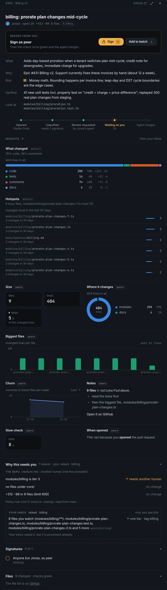

Two layers, kept apart everywhere: the repository says "high risk, needs another human"; your
inbox says "you: raised · auth". Nothing your inbox says is mixed into the repository's reasons.

- **Insights**, in the [detail panel](/docs/dashboard#detail-panel) after the brief and the
  journey (on a phone, after the brief): one block per analyzer, in your `inbox.ts`'s order, with
  its title and a quiet **default** (one of nod's) or **yours** label. A wide panel puts the
  small ones side by side. An analyzer with nothing to say is left out; with none to show, the
  section is one quiet line. An analyzer still at work says "running…" in its own block, one that
  failed shows its error there; the others are not held up. Opening the panel runs the
  [`open` analyzers](#when-it-runs-and-the-cache) of that pull request.
- **The personal tag** on a row: your inbox's first tag, outlined, with a person glyph, next to
  the repository's tag (filled). A muted pull request says "muted". A row your inbox raised or
  lowered gets no arrow: the panel says why it sits where it sits.
- **Why this needs you** has two groups when your inbox said something: **The repo** (its risk,
  what it needs, its reasons) and **Your inbox** (each mark with the classifier that said it, a
  classifier that failed, and where that put the row: "Raised by your inbox: one line, where the
  repo alone shows it folded"). The fold's summary ends with your line: "1 reason · you: raised ·
  billing".
- **Settings → Inbox** (`#/settings/inbox`): what runs (your `inbox.ts`, or the built-in
  defaults), where, whether it loads, every classifier and analyzer it loaded with its origin and
  `when`, and how to start.

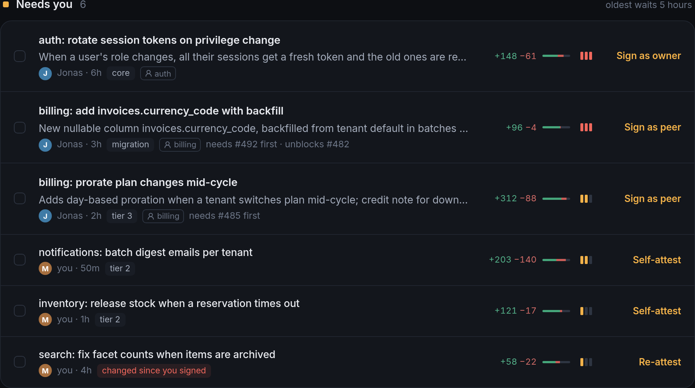

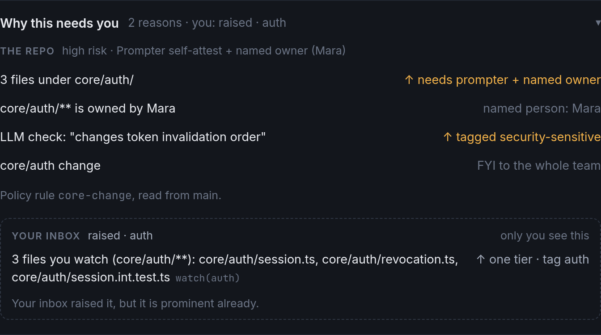

### When it does not load

A syntax error or a bad export in `inbox.ts`: a quiet banner above the list says so, with the
error and its line, and links to Settings → Inbox. Close it and that error stays away in this
browser; a different error shows again. Until the file loads, what your inbox said before stays
on screen and in effect.

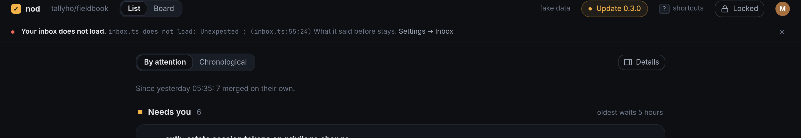

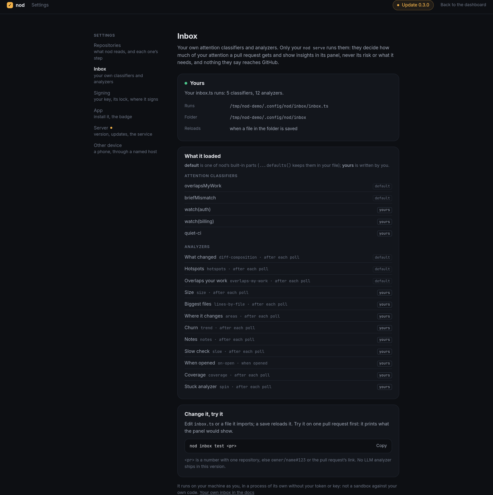

## What it can and cannot change

The adjustment moves a pull request within the tiers, inside two rules it cannot break:

- **What the repository asks of you stays in Needs you.** Down a tier moves a pull request that
  needs your nod or approval from the prominent tier to the normal one, never out of Needs you;
  mute leaves it where the repository put it.
- **An open high-risk pull request is never folded**, nor one that waits on your key: down a tier
  and mute stop at one line.

Everything else follows what you say: up a tier raises a folded pull request to one line, mute
folds it into Background, and "worth knowing" puts an open one into Worth knowing.

## Where it lives

`$XDG_CONFIG_HOME/nod/inbox/` (`~/.config/nod/inbox/` when the variable is unset). `nod inbox
init` writes it:

| File | What |
| --- | --- |
| `inbox.ts` | Your inbox: `export default defineInbox({ … })` |
| `analyzers/todo-count.ts` | An example analyzer to copy: the TODO and FIXME lines a pull request adds |
| `package.json` | Pins `@frebreco/nod`, for your editor's types: run `bun install` there |
| `tsconfig.json` | For your editor |

- **No `inbox.ts`**: the built-in defaults run.
- **With one**: exactly what it lists. `...defaults()` keeps the defaults.
- `nod serve` runs it with **its own kit**, whatever the folder's `node_modules` holds: the
  `package.json` is for the editor only.
- **Save the file and `nod serve` loads it again.** It drops every cached result then, and runs
  the analyzers again; what the dashboard showed stays until the new results are in.
- **A file that does not load** (a syntax error, a bad export): `nod serve` logs why, with the
  line, keeps the last results, and runs nothing until the next save. `nod inbox test` prints the
  error too.

```ts
import { defaults, defineInbox, mute, watch } from "@frebreco/nod/kit/inbox";
import { todoCount } from "./analyzers/todo-count.ts";

const base = defaults();

export default defineInbox({
  classifiers: [
    ...base.classifiers,
    // Up a tier, and a quiet tag on the row, when a PR touches these paths.
    watch("src/auth/**", { tag: "auth" }),
    // Into Background: dependency bumps, and PRs that only touch docs.
    mute({ authors: ["renovate", "dependabot"], paths: ["docs/**"] }),
  ],
  analyzers: [...base.analyzers, todoCount],
  // More for some repositories only (owner/name, or a glob):
  repos: {
    "acme/billing": { classifiers: [watch("migrations/**", { tag: "db", fyi: true })] },
  },
});
```

`repos` only adds; to leave something out for one repository, the classifier or analyzer checks
`ctx.pr.repo` itself.

## Attention classifiers

An attention classifier is a function from a pull request's context to a list of marks, each with
`attention` (`1`, `-1` or `"mute"`), a `tag`, `fyi`, and a `detail` sentence saying why. It never
has a risk.

| Built-in | Does |
| --- | --- |
| `overlapsMyWork()` | Up a tier, tag `my-work`, when someone else's pull request changes files one of your open pull requests changes. A default |
| `briefMismatch()` | Up a tier when the brief declares a risk two levels below what the repository says; a tag when its "Look at" names paths the pull request does not touch. A default |
| `watch(globs, { attention, tag, fyi })` | Up a tier (or what `attention` says) and a tag when a changed file matches |
| `mute({ authors, paths, labels })` | Into Background: by author (`renovate` also matches `renovate[bot]`), by label, or when every changed file matches `paths` |

### Writing a classifier

A classifier is a plain function, sync or async; `classifier(name, fn)` gives it the name the
panel shows next to its marks:

```ts
import { classifier } from "@frebreco/nod/kit/inbox";

// Down a tier while the title says it is a work in progress.
export const wip = classifier("wip", ({ pr }) =>
  /\bwip\b/i.test(pr.title) ? [{ attention: -1, detail: "the title says work in progress" }] : [],
);
```

Put it in `classifiers` in `inbox.ts`. A mark needs a `detail` and at least one of `attention`,
`tag` or `fyi`.

Mute wins over everything; otherwise the ups and downs add up, and the sum moves one tier at most.
A classifier that throws changes nothing: a broken classifier never makes every pull request look
urgent.

## Analyzers

An analyzer has an `id` (lower case, digits and dashes; its cache key), a `title`, and `when`:

- `"poll"`: after a poll, for pull requests whose content changed. For cheap ones.
- `"open"`: when you open the panel on the pull request. For slow ones.

Its `run(ctx)` returns an insight, a block, a list of blocks, or nothing (then it is left out).
`appliesTo(ctx)` can skip pull requests, and `cacheKey(ctx)` adds to the cache key what the result
depends on beyond the diff.

What `ctx` holds, for classifiers and analyzers alike:

| Field | What |
| --- | --- |
| `pr` | The repository (`owner/name`), number, title, body, author, labels, base branch, head |
| `files` | Every changed file with its added and removed lines, from git |
| `diff(paths?)` | The unified diff from the merge base to the head, of some files or all |
| `readBaseFile(path)` | A file on the base branch: trusted, the pull request cannot change it |
| `readHeadFile(path)` | A file as the pull request has it: written by its author, to show, never to trust |
| `git(args)` | Read-only git in nod's clone: `log`, `show`, `diff`, `blame`, `ls-tree` and a few more; options that write files or run programs are refused |
| `revs` | The base tip and the head, for `git` |
| `me` | Your login on the repository's host |
| `myWork` | Your open pull requests, across the dashboard, with their files |
| `repoSummary` | What the repository's layer said: risk, category, tags, FYI, whether the requirement is met |

nod's own clones are blobless: reading a file's contents may fetch it from GitHub, so a diff or a
`git show` is slower than `git log --name-only`.

### Writing an analyzer

`nod inbox init` writes this one into `analyzers/todo-count.ts`: the TODO and FIXME lines a pull
request adds, as two numbers.

```ts
import { defineAnalyzer, stats } from "@frebreco/nod/kit/inbox";

const MARKER = /\b(TODO|FIXME)\b/;

export const todoCount = defineAnalyzer({
  id: "todo-count",
  title: "TODOs added",
  when: "poll",
  async run(ctx) {
    const paths = ctx.files.filter((f) => !f.binary && f.added > 0).map((f) => f.path);
    if (paths.length === 0) return null;
    let todo = 0;
    let fixme = 0;
    for (const line of (await ctx.diff(paths)).split("\n")) {
      if (!line.startsWith("+") || line.startsWith("+++")) continue;
      const hit = MARKER.exec(line)?.[1];
      if (hit === "TODO") todo++;
      else if (hit === "FIXME") fixme++;
    }
    if (todo + fixme === 0) return null;
    return stats([
      { label: "TODO", value: todo },
      { label: "FIXME", value: fixme, tone: fixme > 0 ? "warn" : "neutral" },
    ]);
  },
});
```

Several blocks under one title, with a line for the folded summary, are an insight:

```ts
import { defineAnalyzer, files, insight, stats } from "@frebreco/nod/kit/inbox";

export const tests = defineAnalyzer({
  id: "tests-touched",
  title: "Tests",
  when: "poll",
  run({ files: changed }) {
    const touched = changed.filter((f) => /\.(test|spec)\./.test(f.path));
    return {
      ...insight(
        stats([{ label: "test files", value: touched.length, tone: touched.length ? "good" : "warn" }]),
        files(touched.map((f) => ({ path: f.path, value: f.added + f.removed }))),
      ),
      summary: `${touched.length} test file${touched.length === 1 ? "" : "s"}`,
    };
  },
});
```

### When it runs, and the cache

- `when: "poll"` analyzers run after a poll, for open pull requests whose content changed: keep
  them quick (10 seconds at most).
- `when: "open"` analyzers run when you open the panel on a pull request (60 seconds at most):
  the panel shows "running…" in their block until they are done.
- A result is kept per analyzer and [patch-id](/docs/glossary): a rebase that keeps the patch-id
  keeps it, a new push runs it again. `cacheKey(ctx)` adds what else it depends on. The cache is
  in memory: a restart of `nod serve` runs the `poll` analyzers again, and saving `inbox.ts`
  drops it all.
- An analyzer that fails is shown failed, with its error; an `open` one is tried again the next
  time you open the panel.

The defaults: `diffComposition()` (changed lines as code, tests, comments, docs, config and
generated), `hotspots({ days: 30 })` (which touched files changed most often lately) and the
insight of `overlapsMyWork()` (the files shared with your own pull requests). `familiarity()`
(files you changed before) ships, but is not among them.

## Insights

An insight is a title, an optional one-line summary, and blocks: plain data, never HTML or SVG.
nod draws them with its own colours and shapes. Every block may have a `label` above it.

### breakdown

Parts of a whole, as a stacked bar, or `style: "donut"`; a legend says each part's value and
share, and a part's `note` (`+224 −84`). This is what `diffComposition()` returns.

```ts
breakdown(
  [
    { label: "code", value: 308, tone: "c1", note: "+224 −84" },
    { label: "tests", value: 16, tone: "c2" },
  ],
  { unit: "lines" },
);
```

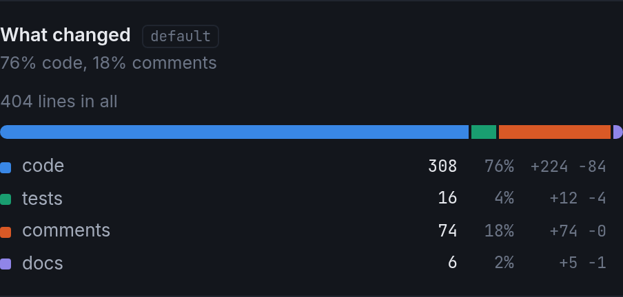

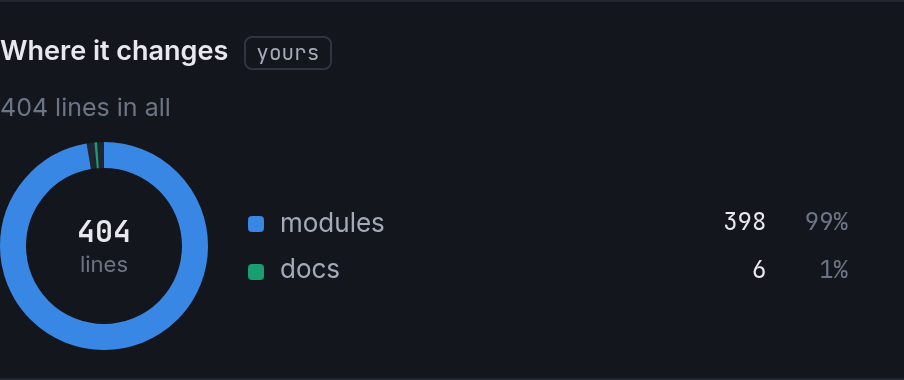

### stats

A few numbers side by side, each with a `unit`, a `hint` and a `tone` (a small mark beside it).

```ts
stats([
  { label: "files", value: 9 },
  { label: "tests", value: 5, unit: "%", tone: "warn", hint: "of the changed lines" },
]);
```

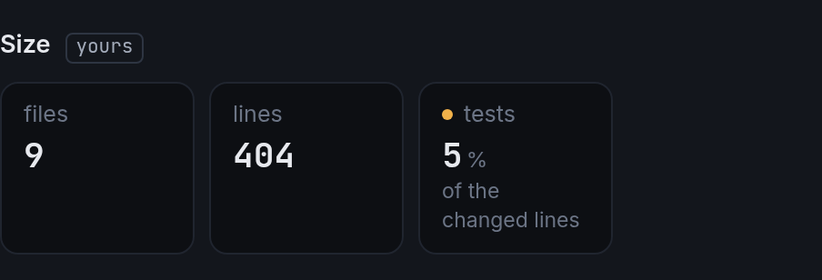

### series

Values over something ordered (weeks, files), as bars or `style: "line"`, from 0 to a round top.
Point at a bar, or tap it, to read its value; the x labels thin out on a narrow panel.

```ts
series(
  [
    { x: "11-15", y: 8 },
    { x: "11-22", y: 7 },
  ],
  { style: "line", label: "commits to these files per week", tone: "info" },
);
```

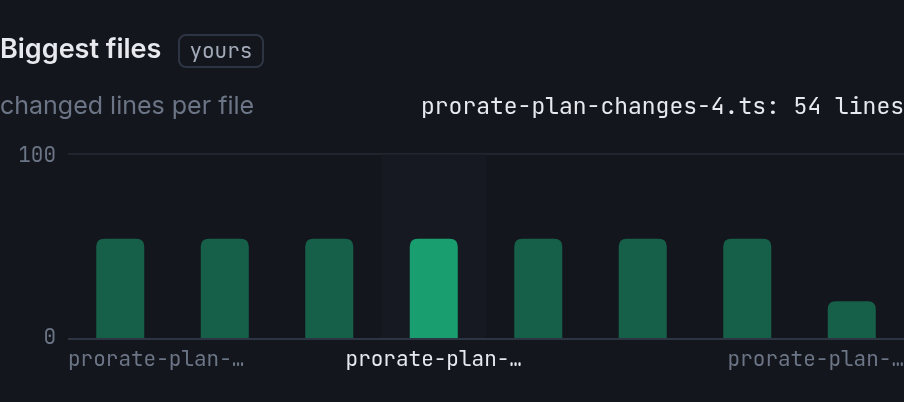

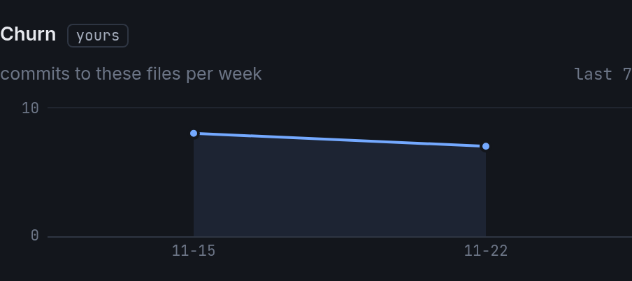

### files

Files, each with a `note`, a `value` (with a small bar) and a pull request (`pr: { number }`, of
the same repository unless it names one). A path opens that file in the pull request's diff on
GitHub; a pull request opens that one. `hotspots()` and `overlapsMyWork()` return this.

```ts
files([
  { path: "core/tenant/context.ts", note: "#490 notifications", pr: { number: 490 } },
  { path: "modules/billing/prorate.ts", note: "3 changes in 30 days", value: 3 },
]);
```

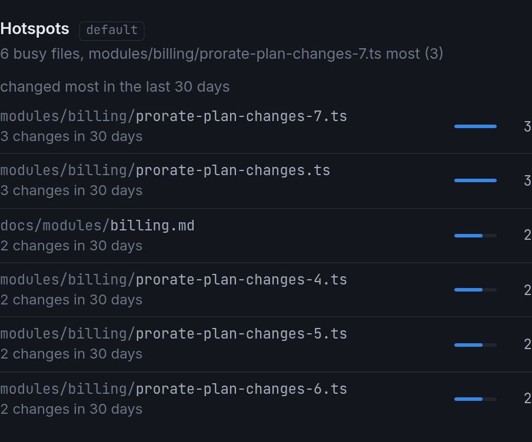

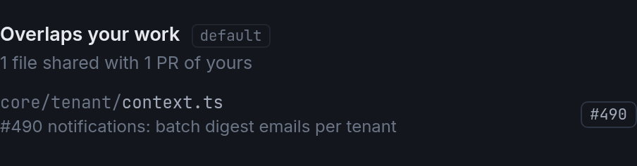

### text

Limited markdown: paragraphs, `-` lists, `**bold**`, `*italic*`, `` `code` `` and
`[links](https://…)` to `http` and `https` only. Everything else, HTML included, is shown as text.

```ts
text("**9 files** in `tallyho/fieldbook`.\n\n- read the tests first");
```

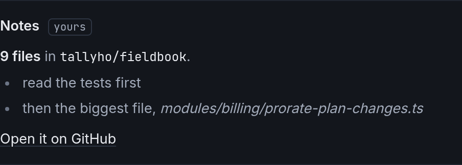

### Running and failed

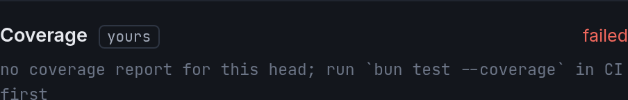

### Tones

Colours are named, never given: a meaning, or a slot of a series.

| Tone | Drawn as | For |
| --- | --- | --- |
| `neutral` | the text's grey | nothing in particular (the default) |
| `muted` | a darker grey | what matters least, such as generated files |
| `info` | blue | a fact worth a glance |
| `good` | green | fine |
| `warn` | amber | worth a look |
| `bad` | red | wrong |
| `c1` … `c6` | blue, teal, orange, violet, yellow, pink | parts that only need to be told apart, in this order |

The six slots are chosen to stay apart for colour-blind eyes too, next to each other; a part
without a tone takes the next slot. Text is never drawn in a tone: a mark beside it carries it.

### Limits

nod checks every insight it gets: unknown blocks and tones are dropped, numbers that are not
numbers are dropped, and sizes are capped (8 blocks, 12 parts, 8 numbers, 120 points, 50 files,
4,000 characters of text). A buggy analyzer shows an empty insight, never a broken panel.

There is no LLM analyzer in this version; one that calls a command you have (with the diff on
its input) would be an `open` analyzer returning `text`.

## Isolation: not a sandbox

Your inbox runs in a subprocess of `nod serve`, not in it:

- It speaks JSON lines over its standard input and output; whatever it sends back is checked
  again.
- Each analyzer has a time limit, 10 seconds for `poll` and 60 for `open`, and the classifiers of
  one pull request 10 seconds. One that runs past it fails; one stuck in a loop is killed with its
  process, which starts again. A process that keeps crashing is started again after a growing
  pause.
- **It never gets the signing key or the pairing token.** Its environment is built from scratch:
  `PATH`, `HOME`, `USER`, `LOGNAME`, `LANG`, `LC_*`, `TZ`, `TMPDIR` and the `XDG_*` folders. No
  GitHub token, nothing of nod's own, nothing of git's.
- **`nod serve` does the git work.** Reads, diffs and `git` run in `nod serve`, which has the
  token a blobless clone needs to fetch contents; the subprocess only gets the results.

**It is not a sandbox against your own code.** `inbox.ts` runs as you, with your files and your
network, like any script you run: it could read nod's token file or run `gh` itself. The
subprocess protects `nod serve` from a crash, a hang or a leak in your code, and keeps the key out
of its memory. Put nothing in your inbox you would not run yourself.

## `nod inbox`

| Command | Does |
| --- | --- |
| `nod inbox init` | Write the files above into the folder. Never over a file that is there; `--force` writes over them |
| `nod inbox test <pr>` | Run your inbox on one pull request, every analyzer (`poll` and `open`), and print what the panel would show. `<n>` with one repository in your list, else `owner/name#<n>`, `host/owner/name#<n>` or the pull request's URL. `--dir <clone>` fetches into that clone instead of nod's own; `--json` prints JSON |
| `nod inbox path` | Print the folder, and whether it has an `inbox.ts` |

`--inbox <path>` works with all three: another folder. `nod serve --inbox <path>` runs that one.

`nod inbox test` uses the same subprocess, time limits and clone as `nod serve`. Its
`repoSummary` is nod's built-in policy's, not the verifier's.

```
$ nod inbox test tallyho/fieldbook#482
tallyho/fieldbook#482 · auth: rotate session tokens on demote · jonas-r
inbox: /home/you/.config/nod/inbox/inbox.ts

attention: +1 (up a tier)
tags: auth
  watch(auth): +1 [auth] 2 files you watch (src/auth/**): src/auth/session.test.ts, src/auth/session.ts

What changed (diff-composition, default, poll)
  50% code, 20% tests
    code: 5 lines (50%)  +4 −1
    tests: 2 lines (20%)  +2 −0
    comments: 1 lines (10%)  +1 −0
    docs: 2 lines (20%)  +2 −0

Hotspots (hotspots, default, poll)
  1 busy file, src/auth/session.ts most (4)
    changed most in the last 30 days
    src/auth/session.ts  4  4 changes in 30 days

Overlaps your work (overlaps-my-work, default, poll): nothing to show

TODOs added (todo-count, yours, poll)
    TODO: 1
    FIXME: 0
```

## Without GitHub

`nod serve --fake --scenario insights` runs an inbox over the fictional team: the defaults, and
analyzers of every block type, one that stays running for a while, one that fails, and one that
never finishes (its process is restarted); a watched path with a tag, and muted CI changes.
`--scenario insights-error` breaks its `inbox.ts` once the first results are in. See
[Fake scenarios](/docs/cli#fake-scenarios).

| To see | Open |
| --- | --- |
| Every block type | #482's panel, or #490's |
| Running | #482's panel within 8 seconds of starting `nod serve`: "Slow check", and "When opened" for 15 seconds after the panel first opens |
| Failed | #485's panel: "Coverage" |
| Killed after its time limit | #490's panel, after 12 seconds: "Stuck analyzer" |
| Shared with your own work | #481's panel: "Overlaps your work", and the tag `my-work` |
| Raised, with a tag | #476 (`auth`), #483 (`billing`, raised from folded to one line) |
| Muted | #478, in Background's cluster, tagged "muted" |
| The banner | `--scenario insights-error`, after the first results |
