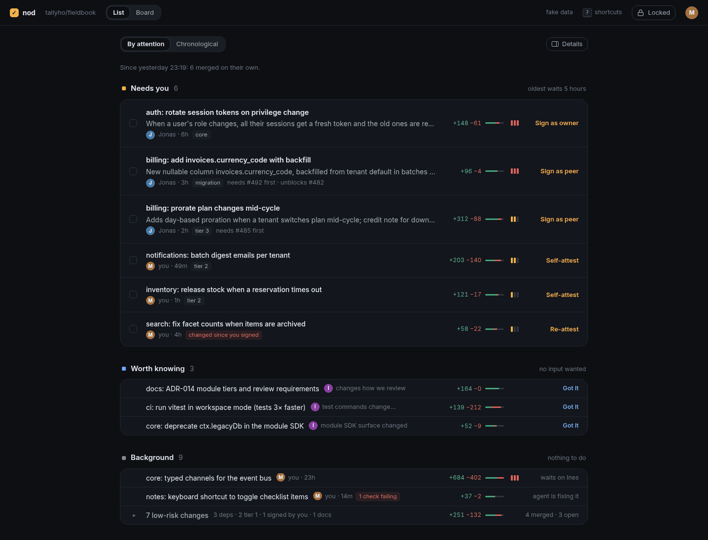

> **nod is a prototype.** It exists to prove a concept, not to be relied on. Its early releases
> (`@frebreco/nod` on npm, the hosted web app at `ui.nod.frebreco.de`) will change; see
> [Status](/docs/status). Read [Security and limits](/docs/security) before you let it gate a
> repository you care about.

Coding agents write most of the code now, and each one opens pull requests. A team of two or
three ends up with far more pull requests than anyone can read. Review has changed: it is less
about reading code and more about staying on top of what is happening.

GitHub's rule, "one approval, not by the author", no longer fits. Agents use your own `gh` login,
so you are the author of what your agent wrote and cannot approve it. And which changes need a
second pair of eyes depends on the change: a docs fix does not, a migration does.

nod is two things.

1. **A dashboard that steers attention.** It shows what needs you now, what is worth knowing, and
   what happens in the background. Each pull request gets screen space in proportion to the
   attention it deserves. [The dashboard](/docs/dashboard)
2. **A signed human attestation, the nod.** You nod pull requests, one or many at once, with a
   signature made by a key the agents don't have. A policy in your own repository decides which
   changes need whose nod, a required check enforces it, and then agents merge on their own.
   [Nodding](/docs/nodding)

## How it fits together

1. An agent opens a pull request and arms auto-merge.
2. A workflow in your repository, the [verifier](/docs/verifier), classifies the pull request with
   your [policy](/docs/policy) and works out the requirement: no nod, a self nod, a peer nod, or a
   nod from a named person. A teammate's plain GitHub approval counts too (not released).
3. The verifier sets the check `nod` on the pull request. A ruleset requires that check, so
   nothing merges while it is red. Until a repository turns that on, the check only shows what is
   needed and blocks nothing (not released).
4. `nod serve` on your machine reads the pull requests and the verifier's results, and the
   dashboard shows you the ones that wait for you.
5. You look, select, and nod. nod posts one signed comment per pull request; the verifier checks
   the signature, the check turns green, and auto-merge merges.

You can start with nothing in the repository: `nod serve` in a clone shows the dashboard for you
alone, and the policy, signing and the required check are steps the dashboard offers, each one
opt-in (not released). [The ladder](/docs/quick-start#the-ladder)

## Local-first

- No GitHub App, no backend, nothing hosted that holds your data. `nod serve` runs on your
  machine with your existing `gh` login.
- All shared state is in GitHub: comments, a check, labels, reactions.
- The policy and the verifier are files in your repository (`.nod/`), readable top to bottom. The
  npm package only provides helpers, the [kit](/docs/architecture#the-kit).

## What it is not

- **Not a code review tool.** nod links to the diff on GitHub. It helps you decide what to look
  at; it does not replace looking.
- **Not a security boundary against a determined agent.** In v1 an agent that sets out to forge
  the check can do it. nod guards against mistakes and unattended merges.
  [Security and limits](/docs/security)
- **Not for many repositories at once.** One repository per `nod serve`, sized for two or three
  people. [Status](/docs/status)

Next: [Quick start](/docs/quick-start), or the terms in the [Glossary](/docs/glossary).
