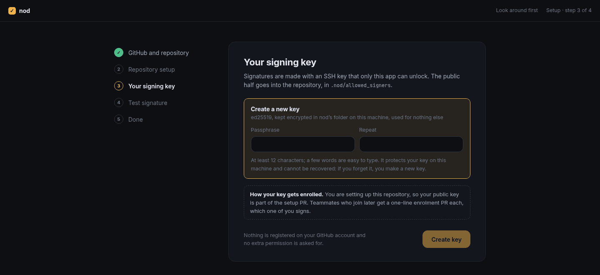
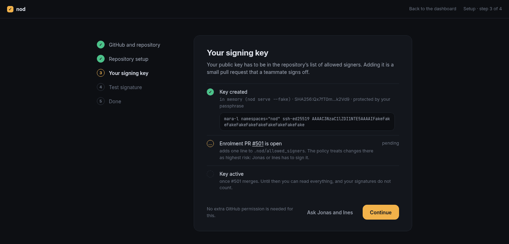

A nod is only worth something if agents cannot make one. Two things carry that: a signing key
the agents don't have, and a list of trusted keys the agents cannot change on their own.

## The trust root

`.nod/allowed_signers` on the default branch lists who can nod. A **signer** is a person with a
line in that file. It is OpenSSH's allowed-signers format, one line per key, and the principal is
the GitHub login:

```
mara-l namespaces="nod" ssh-ed25519 AAAAC3NzaC1lZDI1NTE5AAAAI…
jonas-r namespaces="nod" ssh-ed25519 AAAAC3NzaC1lZDI1NTE5AAAAI…
```

The verifier reads the file from the default branch on every run. So:

- **Adding a key is a pull request** to this file. It is under `.nod/`, so a peer must nod it.
- **Removing a key revokes its nods** on every open pull request at the next run.
- `valid-after="20270101"` and `valid-before="…"` options help rotate a key.

Why a file in the repository and not the SSH signing keys on your GitHub account: registering a
key on GitHub needs the `admin:ssh_signing_key` scope on the `gh` login. Agents share that login,
so any agent could register its own key and forge nods. A file needs no extra scope, and makes
the list of signers reviewable.

## The key file

nod makes its own key: one ed25519 key, used for nothing else.

- It is stored in `$XDG_CONFIG_HOME/nod/signing-key.json` (else `~/.config/nod/`), mode 0600.
- The private half is encrypted with your passphrase (scrypt, then AES-256-GCM). The plain key
  is never written anywhere.
- The public half is in the file in clear, so nod can show it and build your line for
  `.nod/allowed_signers` without the passphrase.
- The passphrase has at least 12 characters. It cannot be recovered: if you forget it, you make a
  new key and enrol it again.

Every process of your user can read the key file, agents included. The passphrase is all that
stands against an offline guess, so choose a real one.

Unlocking decrypts the key into the memory of `nod serve` for 15 minutes, or for one signature.
Locking, the end of the window, and stopping `nod serve` drop it. What that does and does not
protect against is on [Security and limits](/docs/security#passphrase-mode).

nod cannot adopt an existing OpenSSH private key.

## Enrolment

The first signer's key is part of the setup PR, which merges under the repository's old rules.
Everyone after that joins through a one-line pull request.



### A teammate joining

1. They clone the repository, run `nod serve` in it and open the dashboard.
2. Onboarding sees the repository is set up, and asks them to create a key.
3. **Open the enrolment PR** opens a pull request that adds their line to `.nod/allowed_signers`.
4. A signer nods it as peer, and it is merged. From the next poll on their key is active.



A key is in one of three states:

| State | Means | Can do |
| --- | --- | --- |
| **not enrolled** | No open pull request adds it yet | Read everything, sign nothing |
| **pending** | A setup or enrolment PR that adds it is open | Read everything, sign nothing |
| **active** | Its line is on the default branch | Nod |

While your key cannot sign, pull requests that wait for your nod show as one line with no ask.

## From the command line

```sh
nod key create            # create the key; asks for a passphrase twice
nod key show              # print your line for .nod/allowed_signers
nod key test              # unlock, sign a test message, verify it with ssh-keygen
nod key create --replace  # a new key; the old file is kept aside as signing-key.json.replaced-<time>
```

A replaced key is a new key: it needs enrolling again.

## One-human repositories

Changes to `.nod/**` need a peer nod: a signer other than the pull request's author. If you are
the only human in the repository, nobody can give it. Changing the policy, the verifier or the
signers then needs a repository admin to lift the ruleset for that one merge and put it back.
Enrolling a second person in the setup PR avoids this.
