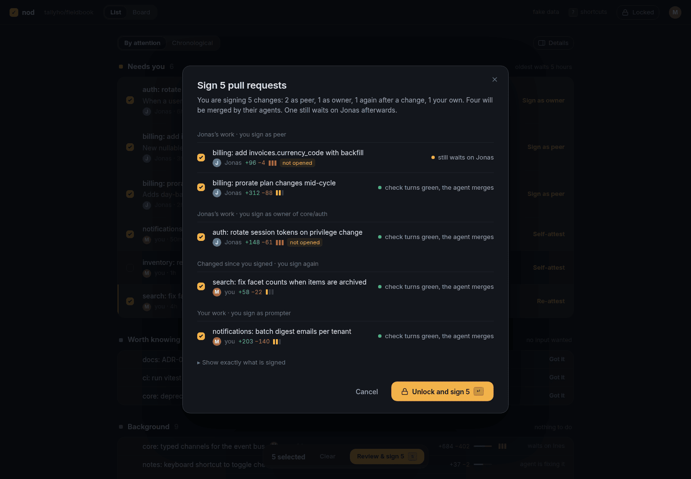
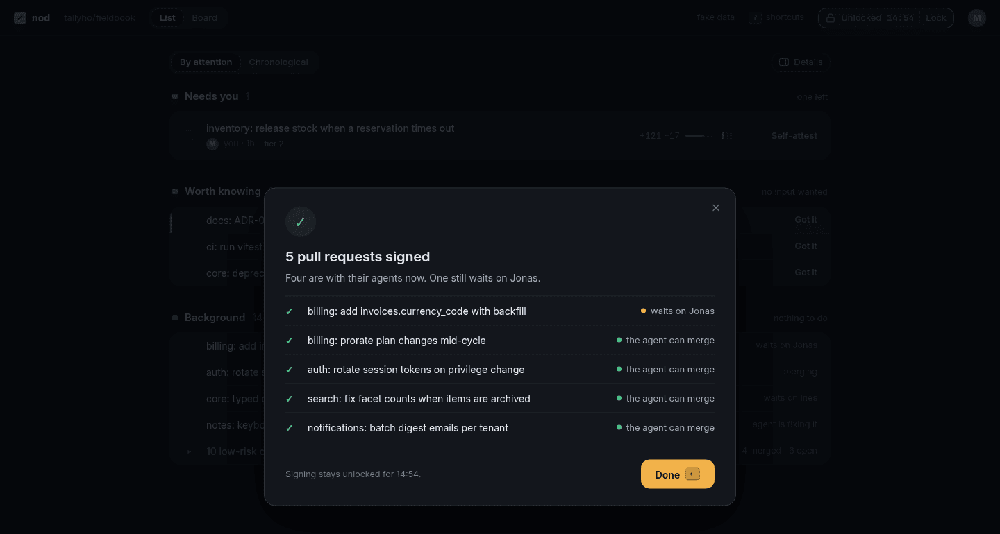

A **nod** is your signed statement that you looked at a pull request and approve it. You make it
in the dashboard; it reaches GitHub as a comment; the [verifier](/docs/verifier) checks it.

## The ask

A pull request that waits for you shows an **ask**, the amber label on the right of its row. The
ask follows from the [requirement](/docs/policy#requirements) the policy set:

| Ask | You sign as | When |
| --- | --- | --- |
| **Self-attest** | self | It is your own agent's work and the policy wants a self nod |
| **Sign as peer** | peer | It is a teammate's work and the policy wants a peer nod |
| **Sign as owner** | named | The policy names you for what it touches |
| **Re-attest** | as before | You nodded, then its content changed |
| **Approve** | a GitHub approval | You have no key that signs in this repository, and an [approval](/docs/policy#approvals) fills what you would fill; or, at the [inbox](/docs/dashboard#the-inbox), a review is requested from you. Not released |

You never pick the role. The verifier decides from the signature whether a nod is a self nod or
a peer nod: a nod by the pull request's author is self, a nod by any other signer is peer.

## Approve or nod

Not released. You do not need a key to take part: without one (no key yet, or one that is
[pending or not enrolled](/docs/keys)), the ask is **Approve**, and the batch dialog posts a plain
GitHub approval for you, the same as **Approve** on GitHub's review page (`gh pr review --approve`):

- **At the inbox step** (no `.nod/` in the repository), a teammate's pull request whose review is
  requested from you or your team asks for an approval. Approving answers the request: the row
  leaves **Needs you**.
- **In a repository with a shared policy**, a slot you could fill asks for an approval when the
  policy lets approvals fill it. A slot the policy keeps for nods (`peer({ approvals: false })`,
  and any change to nod's own setup) still waits for your nod.
- **Your own pull request gets no Approve.** GitHub does not let you approve what you authored, and
  your agent writes with your login. The panel says so quietly; that is what a nod adds: a self
  nod attests your own agent's work.
- **With a key that signs** in the repository, the ask is a nod, as before.

| | Approval | Nod |
| --- | --- | --- |
| Needs | your `gh` login | a key enrolled in `.nod/allowed_signers`, and its passphrase |
| Covers | the head commit you looked at | the head commit and the patch-id |
| After a clean rebase | gone: GitHub records the commit only | still counts |
| On your own pull request | not possible | a self nod |
| On nod's own setup | does not count | counts |
| Who can make it | anyone your `gh` login lets act as you, an agent too | only someone who unlocks the key |

## The batch dialog

Every way to sign opens the same dialog: <kbd>s</kbd> on a row, the selection bar's
**Review & sign**, the detail panel's **Sign**. A batch is one or more pull requests signed with
one signature. It may mix your own work and your teammates'.

Approving goes through the same dialog (not released): **Review & approve**, then **Approve on
GitHub**. No passphrase is asked; each pull request gets an approving review of the head commit you
looked at. A batch is either nods or approvals: a row that asks for the other one stays in view,
left out, with "approve it in a batch of its own" or "sign it in a batch of its own".



The dialog shows:

- one sentence that sums the batch up;
- the rows grouped by the role you sign in, each with what happens after your nod: "check turns
  green, the agent merges", or "still waits on Jonas" when the requirement needs more than you;
- **not opened** on a teammate's pull request whose details you never opened here. Signing is
  still your call;
- **Show exactly what is signed**: the pull request number, base branch, head commit and
  patch-id of every row.

You can take a row out of the batch and put it back before signing.

## Unlocking

Your signing key is locked until you enter its passphrase. The dialog asks for it in place, with
a choice:

- **for 15 minutes**: signing stays unlocked for that window, and the lock chip in the top bar
  counts down. Lock it early from the chip.
- **just this once**: the key locks again right after this signature.

The passphrase goes to `nod serve` on your machine and nowhere else. A wrong passphrase fails
after a second. See [Signing keys](/docs/keys) for where the key lives.

## What exactly is signed

One line of JSON, the **payload**, with one entry per pull request:

```json
{"v":1,"repo":"tallyho/fieldbook","entries":[{"pr":482,"base":"main","head_sha":"9f3c2ab…","patch_id":"e41b7c0d…"},{"pr":490,"base":"main","head_sha":"77d1c3e…","patch_id":"c5521b08…"}],"verdict":"approve","level":"review","reviewer":"mara-l","signed_at":"2026-11-18T14:20:00.000Z"}
```

The signature is an SSH signature (SSHSIG, namespace `nod`) over exactly those bytes, made by
your ed25519 key. nod posts the same comment on every pull request of the batch: a human-readable
line, then a fenced block with the payload and the signature.

````
**nod** · approve · review · by `mara-l` · #482 #490

```nod
{"v":1,"repo":"tallyho/fieldbook","entries":[…],"verdict":"approve","level":"review","reviewer":"mara-l","signed_at":"…"}
-----BEGIN SSH SIGNATURE-----
…
-----END SSH SIGNATURE-----
```
````

Only the block is signed. The line above it is for people, and who posted the comment never
matters: anyone can paste a nod, and it counts only if the signature verifies for an enrolled
[signer](/docs/keys).



## When a nod counts

A nod counts for a pull request when all of this holds:

- the signature verifies against `.nod/allowed_signers` on the default branch;
- `repo` matches, and the payload has an entry for this pull request;
- the verdict is `approve`;
- the entry's `base` is the pull request's current base branch;
- the entry's `head_sha` **or** its `patch_id` matches the pull request now.

The **patch-id** is a hash of the diff between the pull request and its base, computed with
`git`. It stays the same when the diff stays the same.

| What happens after you nodded | Your nod |
| --- | --- |
| A clean rebase onto a newer base | Still counts, matched by patch-id |
| The base changes a line within 3 lines of the change | Dropped: the diff's context changed. This fails safe |
| A new commit changes the content | Dropped. The row shows "changed since you signed" and asks you to **Re-attest** |
| The pull request is retargeted to another base branch | Dropped: the entry names the old base |
| Your key is removed from `.nod/allowed_signers` | Dropped on every open pull request at the next run |
| The comment is deleted, or its block edited | Dropped |

Every verifier run reads the full current state, so a dropped nod puts the check back to
waiting: red once [enforced](/docs/verifier#enforced-or-not).

A GitHub approval of the head commit fills a slot too, unless the policy asks for a nod only (not
released). It needs no key and no `nod serve`: see [Approvals](/docs/policy#approvals).

## Stale and failed

Two things can go wrong between looking and signing:

- **Stale.** A pull request got new commits after you looked. `nod serve` refuses to sign a head
  you have not seen; the dialog shows what moved and offers **Review again**. Nothing was signed.
- **Posting failed.** The signature was made but a comment did not reach GitHub. The dialog lists
  which pull requests are missing the comment and offers a retry.

Approvals work the same way (not released): one moved pull request and nothing is approved; an
approval GitHub refused is listed with GitHub's reason and a retry, the others stay approved.

## FYI

An **FYI** is a pull request people should notice without anyone having to nod. A policy rule can
mark it, or its author declares it in the brief. It shows as one line under **Worth knowing**.

**Got it** (<kbd>e</kbd>) is the **FYI ack**. It is not signed: nod adds your 👀 reaction to the
pull request, and reads the reactions back to show who has seen it. An FYI ack never affects the
check.

## Deep links

The verifier's sticky comment, and agents, can link into the dashboard:

```
https://ui.nod.frebreco.de/#/pr/<owner>/<repo>/<number>
https://ui.nod.frebreco.de/#/batch/<owner>/<repo>/<number>,<number>
```

A link opens the pull request, or the batch dialog's review step for those pull requests.
**A link never approves by itself**: you still review, unlock and sign. The page does nothing
until it is paired with your `nod serve`; a link opened before pairing is remembered and shown
after. A link for another repository than the one you serve says so. On GitHub Enterprise the
link names the host first, see [GitHub Enterprise](/docs/enterprise#deep-links). On a phone,
the hosted web app can hand a link over to your nod on the named host, one tap per link
(not released): [Links from GitHub](/docs/phone#links-from-github).
