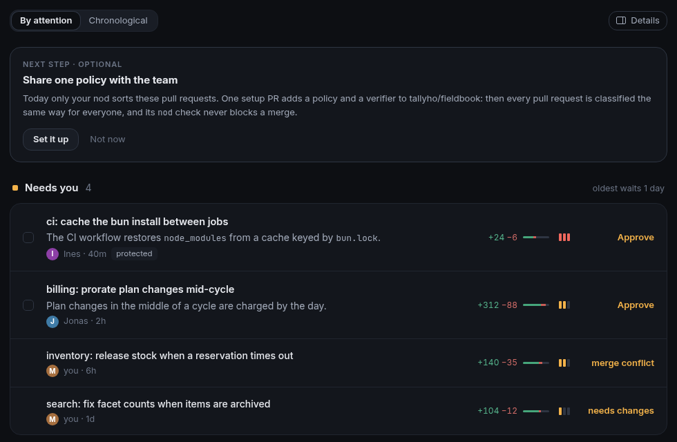
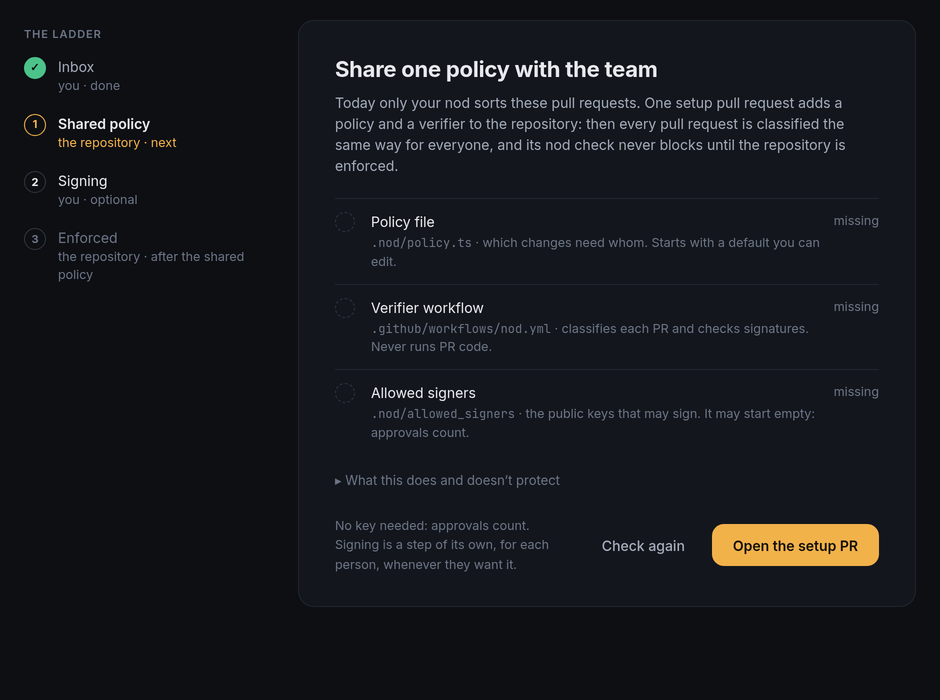

> **This page runs both halves from a checkout**, which also has what is
> [not released](/docs/status#not-released). `@frebreco/nod` is on npm and the hosted web app is
> live at `ui.nod.frebreco.de`: `bunx @frebreco/nod serve` in place of `bun src/cli.ts serve` runs
> the published CLI and opens the hosted web app, without the checkout.

## The ladder

Adopting nod is four steps, and each one is opt-in. The first needs nothing in the repository;
nobody who skips a step loses their normal GitHub workflow.

| Step | Who opts in | What the repository sees | What you get |
| --- | --- | --- | --- |
| **Inbox** | you alone | nothing | the attention dashboard |
| **Shared policy** | the repository, with the setup PR | `.nod/`, and a `nod` check that never blocks | one classification for everyone |
| **Signing** | each person | nod comments from those who enrolled | nodding your own agents' pull requests |
| **Enforced** | the repository, `nod init --ruleset` | a required `nod` check, zero required approvals | agents merge on their own |

Nothing stands between `nod serve` and the dashboard. Each further step is an
[offer](/docs/dashboard#offers): a calm card above the list for the next one, which **Not now**
puts away, and the same steps in the avatar menu. Each opens the setup page, where the steps are
done; [Settings](/docs/settings) in the avatar menu lists every repository with its step and leads
to its ladder.

Not released: the [inbox](/docs/dashboard#the-inbox) on its own (without the shared policy your
`nod serve` classifies the pull requests itself), the offers and the setup page as the ladder, the
check that never blocks, and approvals counting toward the policy. The released version opens
onboarding first.

## What you need

- [Bun](https://bun.sh) 1.4.1 or newer and `git`.
- The GitHub CLI, logged in: `gh auth status`. nod uses that login and asks for no other.
- For signing, OpenSSH's `ssh-keygen`.
- For the last step, enforced, admin rights on the repository. On a private repository, rulesets
  need GitHub Pro, Team or Enterprise.

## 1. Look around with fake data

```sh
git clone https://github.com/FreshlyBrewedCode/nod
cd nod
bun install
bun run dev                    # the web app, on http://localhost:4517
```

In a second terminal, serve a fictional team instead of GitHub:

```sh
bun src/cli.ts serve --fake
```

It prints a link. Open it: this is the [dashboard](/docs/dashboard) with fake data. Any passphrase
except `wrong` unlocks signing. `--scenario inbox` shows the first step, `--scenario join` a
teammate joining; the [CLI reference](/docs/cli#nod-serve) lists them all. Stop it with Ctrl-C when
you have seen enough.

## 2. Day one: your inbox

Run `nod serve` in a clone of the repository you want to try it on. From the nod checkout:

```sh
bun src/cli.ts serve --dir ~/code/your-repo
```

```
nod serve on ws://127.0.0.1:4518 · GitHub · you/your-repo
  open the dashboard:
  http://localhost:4517/#host=…&token=…

  keep this link to yourself: while signing is unlocked, it can sign.
```

Open the link. That is all: the dashboard shows at once, with nothing added to the repository and
no key. `nod serve` reads the repository from the clone's `origin` and polls GitHub every 60
seconds. It fetches pull request commits into the clone as `refs/nod/*` and never checks anything
out.

### More than one repository

Not released. One `nod serve` can read every repository you work in, into one dashboard. Put them
in its [repo list](/docs/cli#nod-repo), then start it anywhere, without `--dir`:

```sh
bun src/cli.ts repo add you/your-repo
bun src/cli.ts repo add acme.ghe.com/finance/ledger    # another GitHub host is fine
bun src/cli.ts serve
```

`nod repo add` checks each repository on GitHub and clones it into nod's
[clone cache](/docs/cli#files-and-environment); you need no clone of your own. Started outside a
clone with an empty list, `nod serve` shows the repositories where you have open pull requests or
review requests, to pick one. The rows then carry a [repo chip](/docs/dashboard#many-repositories).

**Needs you** holds the reviews asked of you or your team and your own stuck pull requests;
**Approve** answers a review request on GitHub, without a key
([The inbox](/docs/dashboard#the-inbox)). If `gh` is not logged in, the page says so and names the
command.



## 3. Share one policy

When you want the team to see the same classification, take the offer **Share one policy with the
team**, or open **Settings** in the avatar menu and **The ladder ›** on the repository's row. The
setup page shows the ladder and what the setup PR
adds: the policy file, the verifier and its workflow, the allowed signers.

**Open the setup PR** opens it. It needs no signing key (not released; the released version asks
for your key first): if you have one, your public key goes in as its first allowed signer, and if
not, `.nod/allowed_signers` starts empty. Approvals count, so a repository where nobody is enrolled
works. Opening it needs write access to the repository.



The setup PR is titled "chore: set up nod (.nod/ and the verifier workflow)". Its description
explains every file and the limits. It adds:

```
.nod/policy.ts                    what a pull request needs before it may merge
.nod/classifiers/module-tier.ts   an example classifier: delete or adapt it
.nod/verify.ts                    the verifier
.nod/allowed_signers              who can nod: your public key, or nobody yet
.nod/package.json, .nod/bun.lock  pin the kit
.nod/.gitignore
.github/workflows/nod.yml         runs the verifier
```

The verifier does not exist until the setup PR is merged, so that PR cannot be gated by it.
Review it and merge it the way your repository merges today.

From then on every pull request gets a `nod` check that says what it needs. Until the repository
is enforced it never blocks a merge (not released): a pull request that still needs someone shows
a grey, neutral check, and the verifier posts no comment. A teammate's plain GitHub approval fills
a slot just like a nod (not released), except for changes to nod's own setup. Those need a signed
nod, so with nobody enrolled they wait until someone is; until the repository is enforced, the
check stays neutral and they merge the usual way.

## 4. Signing

Signing is each person's own step. GitHub does not let you approve your own pull request; a nod
can attest it. The offer **Sign your own agent PRs** (or the **Signing** step of the setup page)
creates your [signing key](/docs/keys): choose a passphrase of at least 12 characters. A key you
have when you open the setup PR goes in with it; otherwise, and for a teammate who joins later,
**Open the enrolment PR** opens a one-line pull request that a signer nods
([A teammate joining](/docs/keys#a-teammate-joining)). The first one, with nobody enrolled to nod
it, merges the usual way while the repository is not enforced. **Test
signature** then unlocks the key, signs a test message and verifies it. Nothing is posted.

Without a key you keep approving on GitHub; the policy counts approvals wherever it takes them.

## 5. Enforced: require the check

When the team is ready, a repository admin makes `nod` the gate of the default branch. An admin's
dashboard offers it, **Let agents merge on their own**, with the command; nod does not run it from
the browser. From the clone:

```sh
bun ~/code/nod/src/cli.ts init --ruleset
```

```
created the ruleset "nod" on you/your-repo: main needs a PR with 0 approvals and a green nod check from GitHub Actions (app 15368); nobody can bypass it.
auto-merge is enabled.
re-ran the verifier on #12: their nod check was neutral, which would pass the new requirement.
```

From now on every change to `.nod/` or `.github/workflows/` needs a peer nod. Enrol someone
first: with nobody in `.nod/allowed_signers`, `nod init --ruleset` still applies the ruleset but
warns that nobody can change nod's own setup any more, not even to enrol a key (not released).
If you are the only human in the repository, read
[One-human repositories](/docs/keys#one-human-repositories) first.

## 6. The first nod

1. Open a pull request, or push a commit to an open one. The verifier runs on pull request events
   and comments; a pull request that was open before the setup shows as "not classified" until it
   runs once.
2. Arm auto-merge on it: `gh pr merge --auto --squash <number>`.
3. In the dashboard the pull request appears under **Needs you**. Press <kbd>s</kbd>, check the
   [batch dialog](/docs/nodding#the-batch-dialog), enter your passphrase.
4. nod posts the signed comment. Within about 15 seconds the `nod` check turns green, and
   auto-merge merges once your other required checks are green too.

A teammate can also just approve the pull request on GitHub (not released): that fills the peer
slot without a key. A teammate whose own nod has no enrolled key yet gets **Approve** in its batch
dialog for the same thing ([Approve or nod](/docs/nodding#approve-or-nod)).

## Without the web app

The same setup from a terminal:

```sh
nod key create                          # asks for a passphrase
nod init --signer "$(nod key show)"     # opens the setup PR
nod init --ruleset                      # after the setup PR merged
```

Here `nod` stands for `bun <the nod checkout>/src/cli.ts`. Every flag is in the
[CLI reference](/docs/cli). Signing itself needs `nod serve` and the web app.
