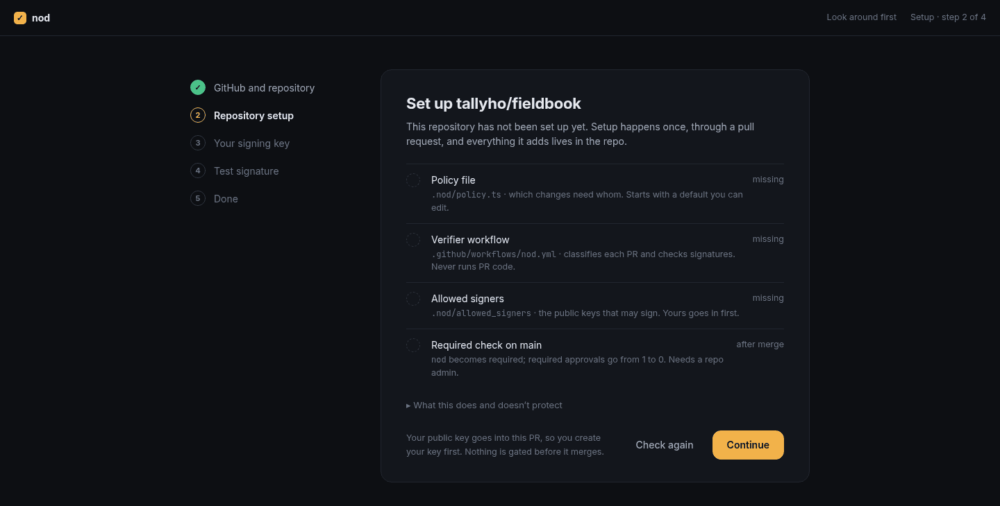

> **This page runs both halves from a checkout**, which also has what is
> [not released](/docs/status#not-released). `@frebreco/nod` is on npm and the hosted web app is
> live at `ui.nod.frebreco.de`: `bunx @frebreco/nod serve` in place of `bun src/cli.ts serve` runs
> the published CLI and opens the hosted web app, without the checkout.

## The ladder

Adopting nod is four steps, and each one is opt-in. Nobody who skips a step loses their normal
GitHub workflow.

| Step | Who opts in | What the repository sees | What you get |
| --- | --- | --- | --- |
| **Inbox** | you alone | nothing | the attention dashboard |
| **Shared policy** | the repository, with the setup PR | `.nod/`, and a `nod` check that never blocks | one classification for everyone |
| **Signing** | each person | nod comments from those who enrolled | nodding your own agents' pull requests |
| **Enforced** | the repository, `nod init --ruleset` | a required `nod` check, zero required approvals | agents merge on their own |

Not released: the check that never blocks, and approvals counting toward the policy. Not built:
the inbox on its own. Without the shared policy, the dashboard lists pull requests as "not
classified" today.

## What you need

- [Bun](https://bun.sh) 1.4.1 or newer, `git`, and OpenSSH's `ssh-keygen`.
- The GitHub CLI, logged in: `gh auth status`. nod uses that login and asks for no other.
- For the last step, enforced, admin rights on the repository. On a private repository, rulesets
  need GitHub Pro, Team or Enterprise.

## 1. Get nod and look around

```sh
git clone https://github.com/FreshlyBrewedCode/nod
cd nod
bun install
bun run dev                    # the web app, on http://localhost:4517
```

In a second terminal, serve a fictional team instead of GitHub:

```sh
bun src/cli.ts serve --fake
```

It prints a link. Open it: this is the [dashboard](/docs/dashboard) with fake data. Any passphrase
except `wrong` unlocks signing. Stop it with Ctrl-C when you have seen enough.

## 2. Serve your repository

Run `nod serve` in a clone of the repository you want to try it on. From the nod checkout:

```sh
bun src/cli.ts serve --dir ~/code/your-repo
```

```
nod serve on ws://127.0.0.1:4518 · GitHub · you/your-repo

  open the dashboard:
  http://localhost:4517/#host=…&token=…

  keep this link to yourself: while signing is unlocked, it can sign.
```

Open the link. `nod serve` reads the repository from the clone's `origin` and polls GitHub every
60 seconds. It fetches pull request commits into the clone as `refs/nod/*` and never checks
anything out.

## 3. Onboarding

The first visit walks through four steps. Each is mostly a list of checks.

1. **GitHub and repository.** Shows the `gh` account and the repository of the clone.
2. **Repository setup.** Lists what is missing: the policy file, the verifier workflow, the
   allowed signers, the required check. One setup PR adds the files.
3. **Your signing key.** Choose a passphrase of at least 12 characters and create the key. Then
   press **Open the setup PR**: your public key is part of it.
4. **Test signature.** Unlocks the key, signs a test message and verifies it. Nothing is posted.



The setup PR is titled "chore: set up nod (.nod/ and the verifier workflow)". Its description
explains every file and the limits. It adds:

```
.nod/policy.ts                    what a pull request needs before it may merge
.nod/classifiers/module-tier.ts   an example classifier: delete or adapt it
.nod/verify.ts                    the verifier
.nod/allowed_signers              who can nod: your public key
.nod/package.json, .nod/bun.lock  pin the kit
.nod/.gitignore
.github/workflows/nod.yml         runs the verifier
```

## 4. Merge the setup PR

The verifier does not exist until the setup PR is merged, so that PR cannot be gated by it.
Review it and merge it the way your repository merges today.

From then on every pull request gets a `nod` check that says what it needs. Until the next step
it never blocks a merge (not released): a pull request that still needs someone shows a grey,
neutral check, and the verifier posts no comment. A teammate's plain GitHub approval fills a slot
just like a nod (not released), except for changes to nod's own setup.

## 5. Require the check

When the team is ready, a repository admin makes `nod` the gate of the default branch, from the
clone:

```sh
bun ~/code/nod/src/cli.ts init --ruleset
```

```
created the ruleset "nod" on you/your-repo: main needs a PR with 0 approvals and a green nod check from GitHub Actions (app 15368); nobody can bypass it.
auto-merge is enabled.
re-ran the verifier on #12: their nod check was neutral, which would pass the new requirement.
```

From now on every change to `.nod/` or `.github/workflows/` needs a peer nod. If you are the only
human in the repository, read [One-human repositories](/docs/keys#one-human-repositories) first.

## 6. The first nod

1. Open a pull request, or push a commit to an open one. The verifier runs on pull request events
   and comments; a pull request that was open before the setup shows as "not classified" until it
   runs once.
2. Arm auto-merge on it: `gh pr merge --auto --squash <number>`.
3. In the dashboard the pull request appears under **Needs you**. Press <kbd>s</kbd>, check the
   [batch dialog](/docs/nodding#the-batch-dialog), enter your passphrase.
4. nod posts the signed comment. Within about 15 seconds the `nod` check turns green, and
   auto-merge merges once your other required checks are green too.

A teammate can also just approve the pull request on GitHub (not released): that fills the peer
slot without a key.

## Without the web app

The same setup from a terminal:

```sh
nod key create                          # asks for a passphrase
nod init --signer "$(nod key show)"     # opens the setup PR
nod init --ruleset                      # after the setup PR merged
```

Here `nod` stands for `bun <the nod checkout>/src/cli.ts`. Every flag is in the
[CLI reference](/docs/cli). Signing itself needs `nod serve` and the web app.
