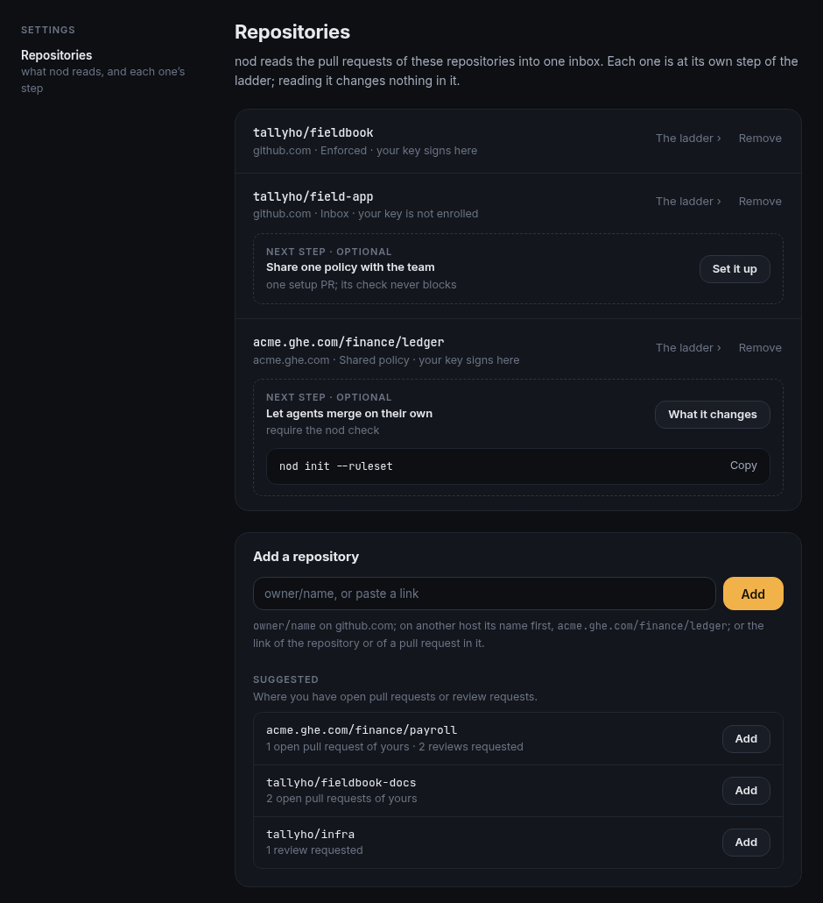
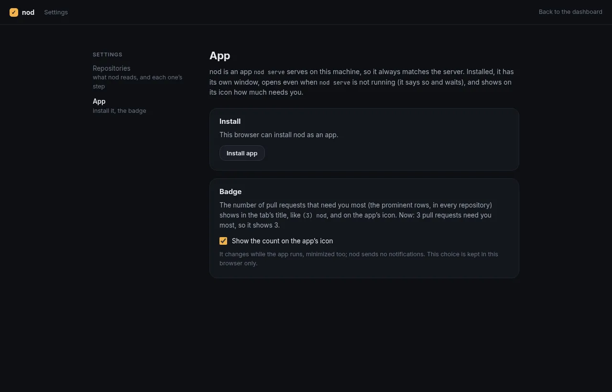
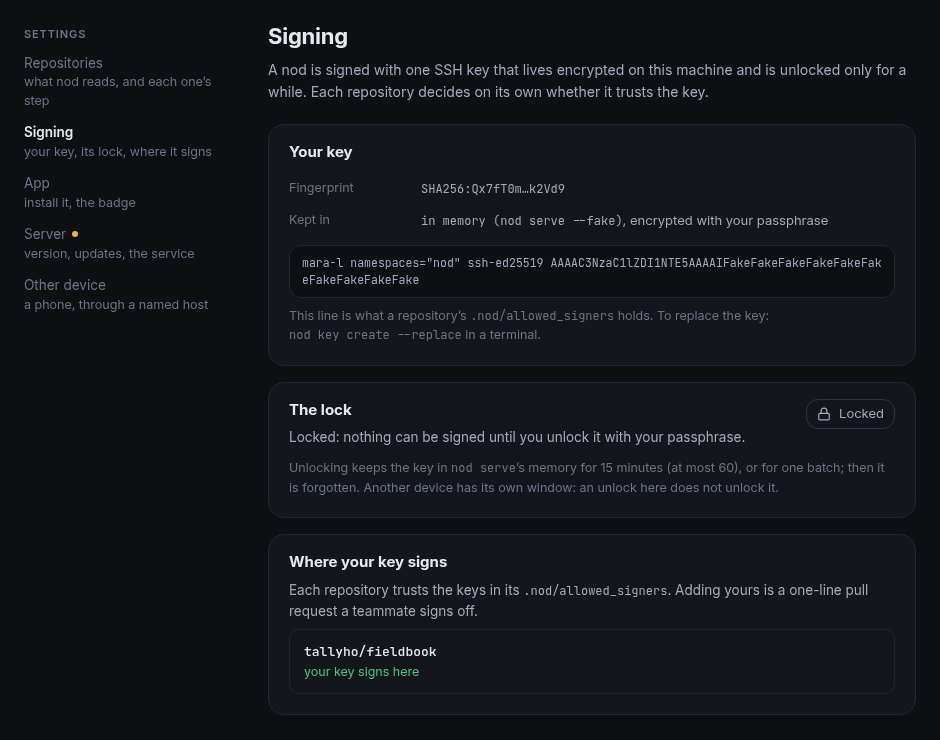
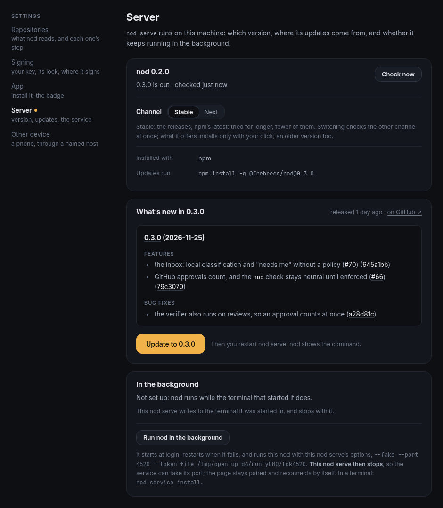

> **Not released.** The settings page is on `main`. It changes the same repo list as
> [`nod repo`](/docs/cli#nod-repo); with `--dir` the list is [fixed](#a-fixed-list).
> `nod serve --fake --scenario repos` shows a list you can change without GitHub.

**Settings** in the avatar menu opens the settings page, `#/settings`. Its sections are listed on
the left (on a phone, as a row of tabs once there is more than one); each one has its own address,
`#/settings/<section>`, so a link opens it directly. The sections: [Repositories](#repositories),
[Signing](#signing), [App](#app), [Server](#server) and [Other device](#other-device). Your own
inbox's settings come later.

## Repositories

`#/settings/repositories`: the [repo list](/docs/glossary), the repositories whose pull
requests share your dashboard. Reading a repository changes nothing in it.

Each row shows:

- the repository, as the dashboard names it: `owner/name` on github.com, `host/owner/name` on
  another host ([GitHub Enterprise](/docs/enterprise));
- its host, its step of the [ladder](/docs/quick-start#the-ladder) (Inbox, Shared policy,
  Enforced), and your key there: "your key signs here", "your key is pending · #501", "your key is
  not enrolled", or "no signing key";
- its next step, the same [offer](/docs/dashboard#offers) the card above the list makes, with its
  button. Here every repository shows its own, and **Not now** on the card does not hide it.
  Enforcing shows the command, `nod init --ruleset`, to run in a clone;
- **The ladder ›**, which opens the repository's [setup page](/docs/quick-start#the-ladder),
  where the steps are done;
- **Remove**, which asks once more. The repository's pull requests leave the dashboard; nothing
  changes in the repository, and you can add it again. Removing the last one leaves an empty list,
  and the dashboard shows "Add a repository" until there is one again.

## Adding a repository

Under the list, **Add a repository** takes a repository in any of these forms:

- `owner/name`, for github.com;
- `host/owner/name`, for another host: `acme.ghe.com/finance/ledger`;
- a link: to the repository, to a pull request or anything else in it, or its clone URL.

**Suggested** lists repositories where you have open pull requests or a review is requested from
you, the busiest first, without those already in the list. **Add** next to one adds it.

`nod serve` checks that your `gh` login on that host can read the repository. One it cannot find
or read is not added, and the page says why. A repository you add starts at the inbox step for
you: nothing of nod needs to be in it.

With no repository at all, the dashboard is a page with the same field and suggestions:
**Add a repository**.

## A fixed list

`nod serve --dir <clone>` (or `nod serve` in a clone while the repo list is empty) reads that one
clone. The section then shows it read-only, with a note that says why and what to run instead:
[`nod repo add`](/docs/cli#nod-repo), then `nod serve` without `--dir`.

## App

`#/settings/app`: the [app](/docs/app) on this browser.

- **Install**: **Install app** where the browser offers it (Chrome, Edge), "installed" once it
  is, or how this browser installs a site (Safari: File, then Add to Dock; Firefox does not). On a
  page that is not the app, such as the hosted web app, it gives the app's address instead.
- **Badge**: what the [badge](/docs/glossary) shows now, and a switch for the count on the app's
  icon, kept in this browser. The tab's title always counts.

## Signing

`#/settings/signing`: your [signing key](/docs/keys) and where it signs.

- **Your key**: its fingerprint, where it is kept (encrypted with your passphrase), and the line a
  repository's `.nod/allowed_signers` holds. With no key, **Create a key** opens the ladder's
  Signing step, where it is made; `nod key create` does the same in a terminal.
- **The lock**: locked, or unlocked and for how long, with the same lock chip as the top bar.
  With a [named host](/docs/phone), the other device has its own unlock.
- **Where your key signs**: each repository with your key's [enrolment](/docs/glossary) there.
  **Open the enrolment PR** opens the one-line pull request a teammate signs; a pending one links
  to it. In a repository that is not set up yet, your key goes in with the setup PR: **With the
  setup PR ›** opens its ladder.

## Server

`#/settings/server`: the `nod serve` this page talks to. The [update](/docs/updates) pill in the
top bar leads here, and the entry in the list of sections has a dot while an update waits.

- **The version** it runs (a checkout says "a development build"), whether an update is out and
  when it last looked, and **Check now**. It also looks by itself, about every 10 minutes.
- **Channel**: **Stable** or **Next**, with what each means. See [the channel](/docs/updates#the-channel).
- **Installed with**: npm, bun, pnpm or yarn, and the command an update runs.
- **What's new**: the [release notes](/docs/updates#release-notes) of the update on offer, and
  **Update to 0.3.0**, which asks once more and shows the command before anything runs. Then
  "Installing…", and then either the service restarts nod and the page reconnects to the new
  version, or, for a `nod serve` started by hand, the command to start it again.
- **In the background**: whether nod runs as a [service](/docs/background), the unit file, the
  command it runs, where its output goes; **Run nod in the background** sets it up from here, and
  **Remove the service…** takes it away. See [set it up from the page](/docs/background#from-the-page).

On the other device (a [named host](/docs/phone)) this section only reads: installing an update,
the channel and the service are changed on the machine nod runs on, and the page says so.

## Other device

`#/settings/other-device`: another device, such as your phone, reaching this `nod serve` through
a [named host](/docs/phone).

- With `--allow-host`, the address it answers on and the [device link](/docs/glossary) as a QR
  code, to scan with that device's camera. The code carries that device's pairing token: it is
  shown only on this machine's page, never on the other device, and it is not offered as text to
  copy. Lost the device? Start `nod serve` once with `--new-remote-token`.
- Without it, the two commands that set it up with Tailscale, and a link to
  [On your phone](/docs/phone).
